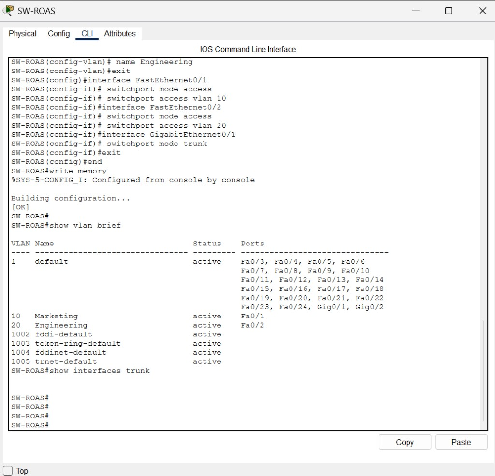
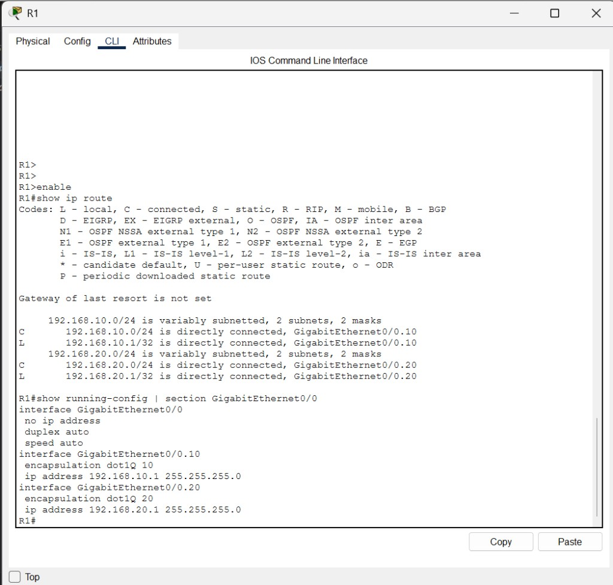
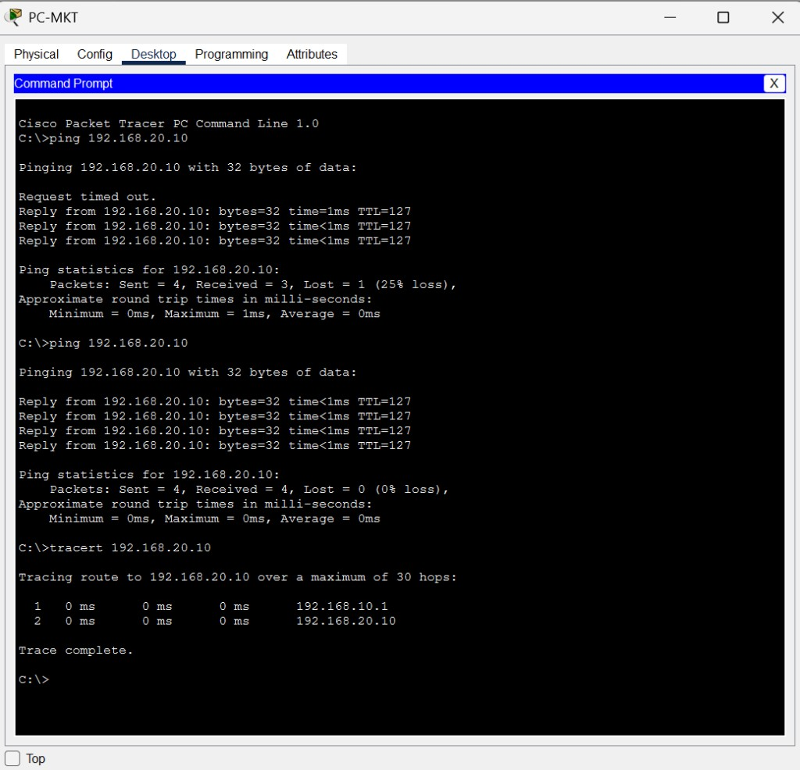
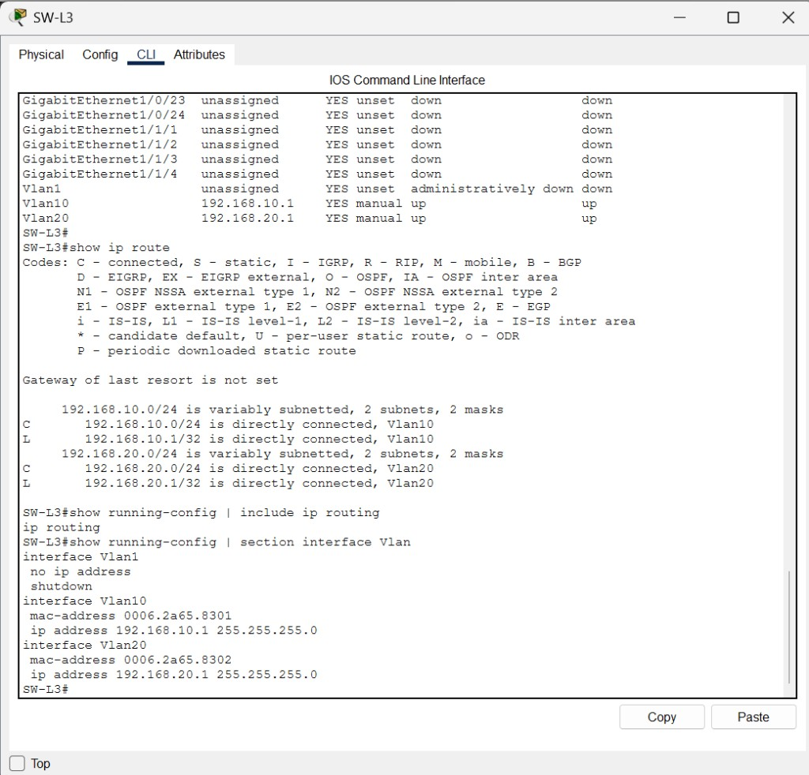
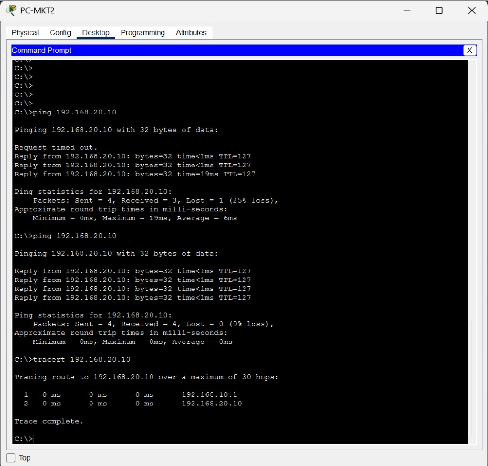
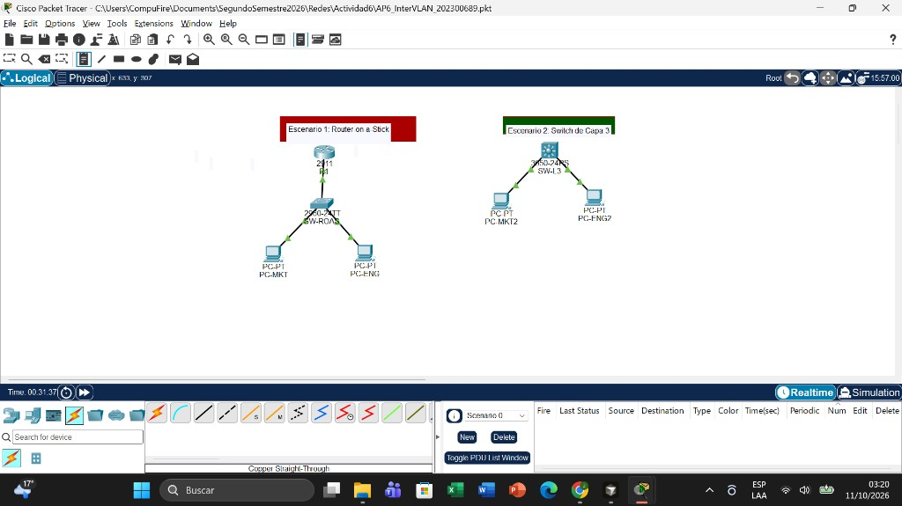

# Universidad de San Carlos de Guatemala

Facultad de Ingeniería  
Escuela de Ingeniería en Ciencias y Sistemas  
Redes de Computadoras 1 — Segundo semestre 2026

**Actividad práctica 6: enrutamiento Inter-VLAN**  
**Estudiante:** Josue Daniel Herrera Cottom  
**Carné:** 202300689  
**Fecha:** 11 de octubre de 2026  
**Archivo:** `AP6_InterVLAN_202300689.pkt`

---

## 1. Introducción

La actividad pide comunicar dos departamentos que están en VLANs distintas y comparar dos maneras de hacerlo. Marketing queda en la VLAN 10 y Engineering en la VLAN 20. Un switch de capa 2 separa esas redes, así que hace falta un equipo de capa 3 para pasar de una a la otra.

Se armaron dos escenarios independientes en el mismo archivo de Packet Tracer. El primero usa Router-on-a-Stick: un router 2911 con subinterfaces 802.1Q y un switch 2960. El segundo usa un switch multicapa 3650, con una interfaz virtual por VLAN y el comando `ip routing`. Los dos lados no están cableados entre sí, por eso pueden repetir las mismas direcciones sin conflicto.

## 2. Objetivos

El objetivo de la práctica es implementar enrutamiento Inter-VLAN con Router-on-a-Stick y con un switch de capa 3, de modo que una PC de Marketing alcance a una PC de Engineering.

| Dimensión | Aplicación en esta práctica |
|-----------|-----------------------------|
| Específico | Configurar 2 VLANs, subinterfaces en el router y SVI en el switch de capa 3. |
| Medible | Ping con 0 % de pérdida y tracert que muestre la puerta de enlace. |
| Alcanzable | Solo con Cisco Packet Tracer y comandos de subinterfaces y SVI. |
| Realista | Ver qué método conviene cuando el tráfico entre departamentos crece. |
| A tiempo | Evidencia entregada con el archivo `.pkt` y este informe. |

## 3. Direccionamiento

La guía no fija las direcciones. Se usó una red por VLAN y la puerta de enlace `.1` en el equipo de capa 3.

| VLAN | Nombre | Red | Puerta de enlace | PC |
|------|--------|-----|------------------|----|
| 10 | Marketing | 192.168.10.0/24 | 192.168.10.1 | 192.168.10.10 |
| 20 | Engineering | 192.168.20.0/24 | 192.168.20.1 | 192.168.20.10 |

En el escenario 1 la puerta de enlace vive en las subinterfaces de `R1`. En el escenario 2 vive en `Vlan10` y `Vlan20` de `SW-L3`. La máscara en todos los hosts es `255.255.255.0`.

## 4. Escenario 1: Router-on-a-Stick

### 4.1 Topología y puertos

| Equipo | Modelo | Función |
|--------|--------|---------|
| R1 | 2911 | Enruta entre las dos VLANs |
| SW-ROAS | 2960-24TT | Acceso de las PCs y troncal hacia el router |
| PC-MKT | PC-PT | Marketing, VLAN 10 |
| PC-ENG | PC-PT | Engineering, VLAN 20 |

| Origen | Puerto | Destino | Puerto | Cable | Modo |
|--------|--------|---------|--------|-------|------|
| PC-MKT | FastEthernet0 | SW-ROAS | FastEthernet0/1 | Directo | Acceso VLAN 10 |
| PC-ENG | FastEthernet0 | SW-ROAS | FastEthernet0/2 | Directo | Acceso VLAN 20 |
| SW-ROAS | GigabitEthernet0/1 | R1 | GigabitEthernet0/0 | Directo | Troncal 802.1Q |

El switch crea las VLAN 10 y 20, deja Fa0/1 y Fa0/2 en modo acceso y pone Gi0/1 en modo trunk. El router no lleva dirección en la interfaz física. Cada subinterfaz etiqueta la VLAN con `encapsulation dot1Q` y recibe la puerta de enlace de ese departamento.

```
interface GigabitEthernet0/0
 no ip address
 no shutdown
interface GigabitEthernet0/0.10
 encapsulation dot1Q 10
 ip address 192.168.10.1 255.255.255.0
interface GigabitEthernet0/0.20
 encapsulation dot1Q 20
 ip address 192.168.20.1 255.255.255.0
```

`show vlan brief` deja Fa0/1 en Marketing y Fa0/2 en Engineering. `show ip route` en R1 muestra las dos redes como conectadas: `192.168.10.0/24` por GigabitEthernet0/0.10 y `192.168.20.0/24` por GigabitEthernet0/0.20.





### 4.2 Prueba

Desde PC-MKT se hizo ping a 192.168.20.10. El primer intento perdió un paquete mientras se armaba la tabla ARP. El segundo terminó en 4 enviados, 4 recibidos y 0 % de pérdida.

El tracert muestra el camino real del tráfico:

1. 192.168.10.1, subinterfaz de la VLAN 10 en R1.
2. 192.168.20.10, PC-ENG.

La trama sale de Marketing sin etiqueta de VLAN en el puerto de acceso, el switch la etiqueta en el troncal, el router la recibe en la subinterfaz .10, cambia de red y la devuelve por la subinterfaz .20.



## 5. Escenario 2: switch de capa 3

### 5.1 Topología y puertos

| Equipo | Modelo | Función |
|--------|--------|---------|
| SW-L3 | 3650-24PS | Conmuta y enruta entre las dos VLANs |
| PC-MKT2 | PC-PT | Marketing, VLAN 10 |
| PC-ENG2 | PC-PT | Engineering, VLAN 20 |

| Origen | Puerto | Destino | Puerto | Modo |
|--------|--------|---------|--------|------|
| PC-MKT2 | FastEthernet0 | SW-L3 | GigabitEthernet1/0/1 | Acceso VLAN 10 |
| PC-ENG2 | FastEthernet0 | SW-L3 | GigabitEthernet1/0/2 | Acceso VLAN 20 |

En el 3650 los puertos nacen como interfaces de capa 3. Por eso cada puerto de PC lleva primero `switchport` y después `switchport mode access`. Sin esa línea la computadora no entra a la VLAN.

```
ip routing
interface GigabitEthernet1/0/1
 switchport
 switchport mode access
 switchport access vlan 10
 no shutdown
interface GigabitEthernet1/0/2
 switchport
 switchport mode access
 switchport access vlan 20
 no shutdown
interface Vlan10
 ip address 192.168.10.1 255.255.255.0
 no shutdown
interface Vlan20
 ip address 192.168.20.1 255.255.255.0
 no shutdown
```

`ip routing` es el comando que convierte esas interfaces virtuales en puertas de enlace. Sin él el switch conoce las dos redes, pero no reenvía paquetes de una a la otra. `show ip route` las muestra conectadas por Vlan10 y Vlan20.



### 5.2 Prueba

PC-MKT2 tenía al inicio la puerta de enlace escrita en el campo DNS y el gateway en 0.0.0.0. Con eso el ping a Engineering se perdía completo, porque la PC no sabía hacia dónde enviar una red distinta de la suya. Al pasar `192.168.10.1` al Default Gateway, el segundo ping quedó en 0 % de pérdida.

El tracert confirma que el salto ya no es el router 2911:

1. 192.168.10.1, interfaz Vlan10 de SW-L3.
2. 192.168.20.10, PC-ENG2.



## 6. Topología completa

Los dos escenarios quedan en el mismo lienzo y no comparten cables. Las luces verdes indican que los enlaces de acceso y el troncal del router están arriba.



## 7. Análisis técnico

Para una red empresarial con mucho tráfico entre departamentos, el método más eficiente es el switch de capa 3.

En Router-on-a-Stick cada paquete que cambia de VLAN sube por el único troncal, lo procesa el CPU del router y regresa por el mismo cable. Ese enlace se vuelve el cuello de botella: el ancho de banda de todas las VLANs compite por un solo puerto, y la latencia crece cuando el router está ocupado. Sirve para una oficina pequeña, con pocas VLANs y poco tráfico entre ellas, porque aprovecha un router que ya existe y un switch de capa 2.

En el 3650 la decisión de capa 3 ocurre dentro del mismo equipo, en hardware. No hay un cable externo que concentre el tráfico entre Marketing y Engineering, y las SVI permiten agregar VLANs sin crear una subinterfaz y un salto extra hacia un router. Para alto tráfico, menor latencia y más departamentos, el switch multicapa escala mejor. El router sigue teniendo sentido como salida a otras redes o a Internet, no como único camino entre VLANs del mismo edificio.

## 8. Conclusiones

1. Las dos VLANs quedan aisladas en capa 2 y se comunican solo cuando existe una puerta de enlace de capa 3.
2. Router-on-a-Stick cumple con un troncal 802.1Q y una subinterfaz por VLAN. La prueba lo muestra: el tracert pasa por 192.168.10.1 en R1.
3. El switch de capa 3 cumple lo mismo con SVI e `ip routing`. El tracert pasa por 192.168.10.1 en SW-L3, sin usar el router.
4. Cuando el tráfico entre VLANs es alto, el switch multicapa evita el cuello de botella del enlace único hacia el router.

## 9. Referencias

1. Guía de la actividad práctica de Inter-VLAN, Redes de Computadoras 1, Escuela de Ingeniería en Ciencias y Sistemas, USAC, segundo semestre 2026.
2. Cisco Networking Academy. CCNA v7, Switching, Routing, and Wireless Essentials. Módulo 4: Inter-VLAN Routing.
3. Cisco IOS. Comandos de referencia usados: `encapsulation dot1Q`, `interface vlan`, `ip routing`, `show ip route`, `show vlan brief`.
