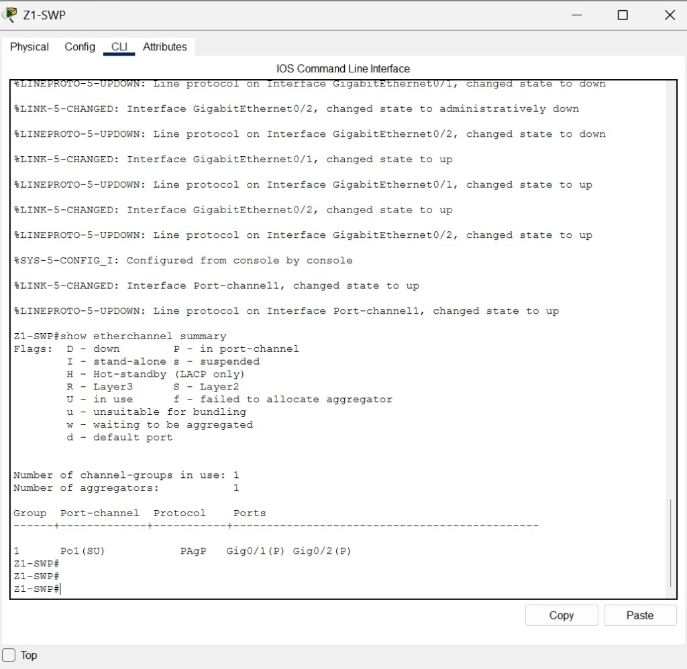
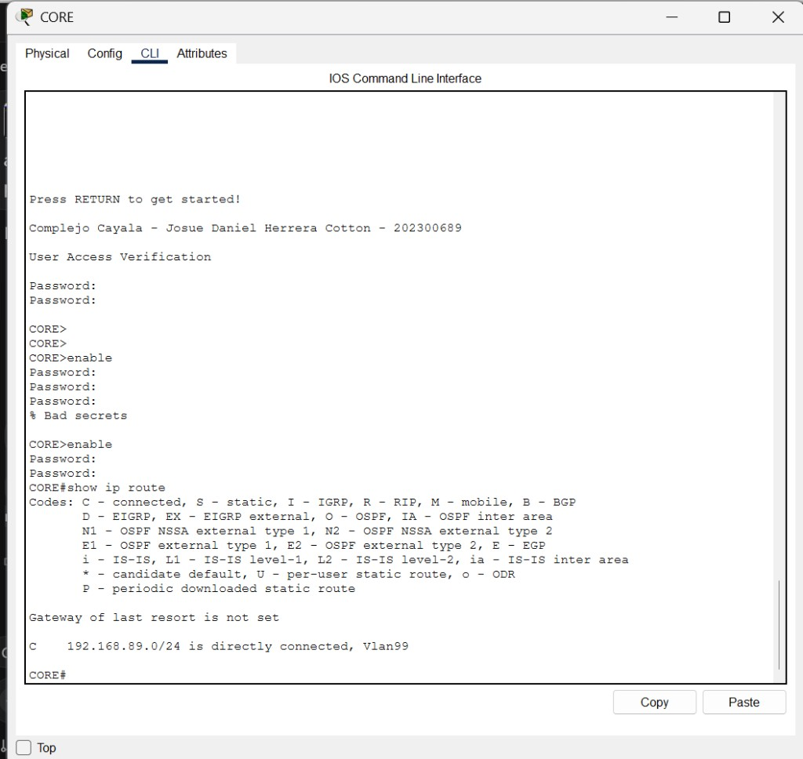
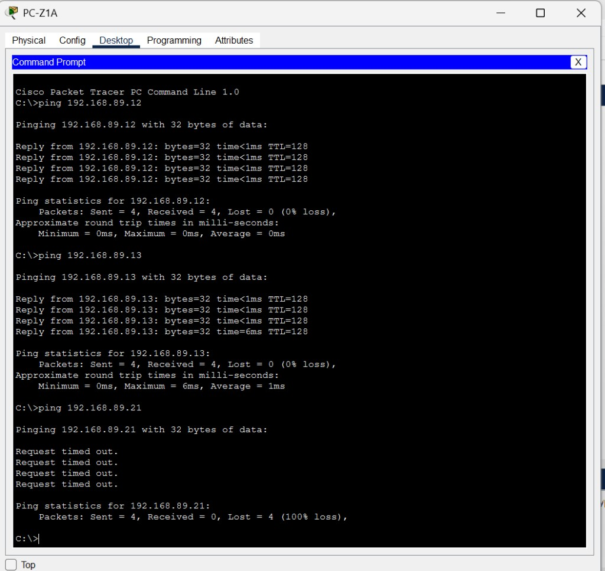
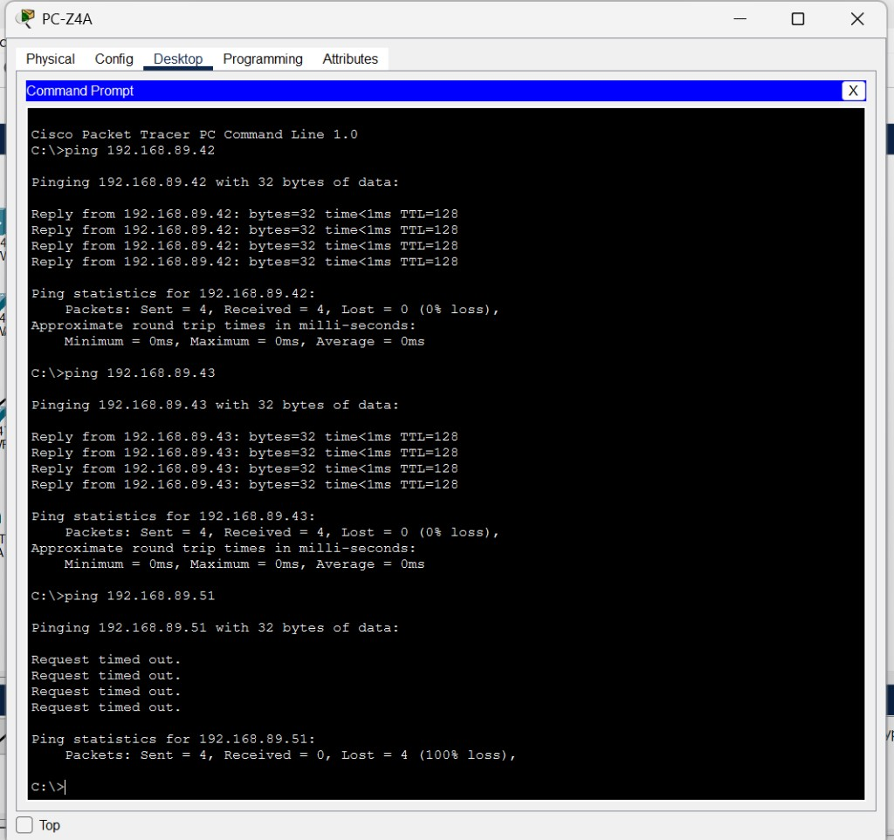

# Informe de desarrollo — Práctica 2

**Proyecto:** Red de la Ciudad Comercial Cayalá  
**Autor:** Josue Daniel Herrera Cottom  
**Carné:** 202300689  
**Curso:** Redes de Computadoras 1 — FIUSAC — Segundo semestre 2026  
**Documento complementario:** [Manual_Tecnico.md](Manual_Tecnico.md) · [codigo_fuente.md](codigo_fuente.md)

---

## 1. Propósito

El manual técnico describe la red que quedó funcionando. Este informe describe lo que se rompió mientras se armaba y qué cambio de configuración lo corrigió. El trabajo se hizo en Cisco Packet Tracer, con switches 2960 y 3560, y toda la lógica se cargó por CLI.

## 2. Cómo se construyó

1. Se eligieron cinco lugares reales del complejo y se les asignó un esquema distinto según criticidad y cantidad de hosts.
2. Se colocaron 11 switches y 12 PCs. No se dibujaron los 157 hosts del enunciado: cada zona lleva 2 o 3 PCs como representación.
3. Se cableó con recto hacia las PCs y cruzado entre switches.
4. Se asignó 192.168.89.0/24 a todas las PCs, con la .1 reservada para CORE.
5. Se configuró primero CORE (VTP transparente), después los cinco servidores VTP y al final los cinco clientes.
6. Se probaron 10 pings dentro de las zonas y 3 pings entre zonas.

## 3. Problema: el EtherChannel no agrupaba los cables

### Qué se veía

Entre CORE y Z1-SWP, `show etherchannel summary` mostraba `Po1(SD)` y los dos Gigabit en estado `(s)` (suspendido). El protocolo sí decía PAgP, pero el canal estaba abajo. En `show ip interface brief` esos puertos salían `up/down`: el cable estaba conectado y la capa 2 no reenviaba.

### Primer mensaje

```text
%EC-5-CANNOT_BUNDLE2: Gi0/1 is not compatible with Po1 and will be suspended (vlan mask is different)
```

La lista de VLANs permitidas se había escrito en los puertos físicos **antes** de crear el grupo. Al nacer, `Port-channel1` trae todas las VLANs. El puerto físico ya traía solo 1, 19 y 99. PAgP compara esas dos máscaras, no coinciden y suspende el puerto.

### Segundo mensaje, después de rehacer el grupo

```text
%EC-5-CANNOT_BUNDLE2: Gi0/1 is not compatible with Po1 and will be suspended (native vlan of Gi0/1 is 99, Po1 id 1)
```

El mismo error, ahora con la VLAN nativa. Los Gigabit ya tenían nativa 99. El `Port-channel1` nuevo nace con nativa 1. Otra vez no coinciden y el canal queda suspendido.

### Solución

Se borró el grupo en los dos extremos y se volvió a crear **sin** fijar la nativa ni la lista de VLANs en el puerto físico antes de entrar al canal. El orden que sí negoció fue:

1. `default interface` en GigabitEthernet0/1 y 0/2.
2. Encapsulación 802.1Q y `switchport mode trunk` (la nativa se queda en 1, igual que el canal nuevo).
3. `channel-protocol pagp` y `channel-group 1 mode desirable`.
4. Recién entonces, en `interface Port-channel1`, nativa 99 y `allowed vlan 1,19,99`.
5. Un `shutdown` / `no shutdown` de los dos Gigabit para que PAgP vuelva a evaluar.

Después de aplicarlo en CORE y en Z1-SWP, el resultado fue `Po1(SU)`, protocolo PAgP y `Gig0/1(P) Gig0/2(P)`. Los dos cables del Paseo quedaron activos dentro de un solo canal lógico.



## 4. Avisos de VLAN nativa distinta

Mientras un extremo del troncal ya usaba la nativa 99 y el otro seguía en la nativa de fábrica (VLAN 1), aparecía:

```text
%CDP-4-NATIVE_VLAN_MISMATCH: Native VLAN mismatch discovered on FastEthernet0/1 (99), with Switch FastEthernet0/24 (1).
```

No era un cable mal puesto. Era el orden de configuración: CORE y los principales ya tenían nativa 99, y el switch de acceso todavía no se había tocado. Al configurar cada vecino con la misma nativa 99, el aviso de ese enlace dejó de aplicar. El aviso de Fa0/1 en Z1-SWP, por ejemplo, desapareció como condición de diseño cuando Z1-SWA quedó en nativa 99.

## 5. Puertos en BLK justo después de pegar

En Z2-SWP, Z3-SWP y Z4-SWP, `show spanning-tree` ejecutado en el mismo pegado mostró los troncales como `Desg BLK`. En el mismo instante el registro decía que el protocolo de línea acababa de bajar y subir. Rapid PVST+ todavía no había pasado a reenvío.

Unos segundos después, `show interfaces trunk` ya mostraba la VLAN de la zona en estado forwarding. En Z5-SWP, Fa0/23 reenviaba las VLAN 59 y 99, y Fa0/24 reenviaba la 59 sin reenviar la 99: el segundo cable quedó como reserva para la VLAN de administración. Ese bloqueo es el comportamiento esperado, no un fallo.

## 6. Aislamiento entre zonas

Los pings dentro de una zona respondieron. Los pings hacia otra zona, con direcciones de la misma red 192.168.89.0/24, respondieron `Request timed out`.

No se agregó un router ni una SVI por cada VLAN. Una segunda SVI en el mismo prefijo sería rechazada por el switch. La regla de direccionamiento del curso pide una sola subred, y el objetivo de la práctica pide comprobar el aislamiento entre VLANs. Las dos cosas se cumplen juntas: la misma red permite el ping directo dentro de la VLAN, y la VLAN impide que ese ping cruce de zona.

`show ip route` en CORE confirma que la única red de capa 3 es la de administración:

```text
C    192.168.89.0/24 is directly connected, Vlan99
```







## 7. Resultado

La simulación queda con cinco servidores VTP (uno por zona), cinco clientes, CORE en modo transparente, Rapid PVST+ con el root explícito de cada VLAN, EtherChannel PAgP en el Paseo y puertos libres en la VLAN 999 apagados. Los 10 pings de la misma zona tuvieron 0 % de pérdida. Los pings entre zonas tuvieron 100 % de pérdida.

Antes de entregar, el archivo de Packet Tracer se guarda como `Practica2_202300689.pkt` dentro de esta carpeta.
