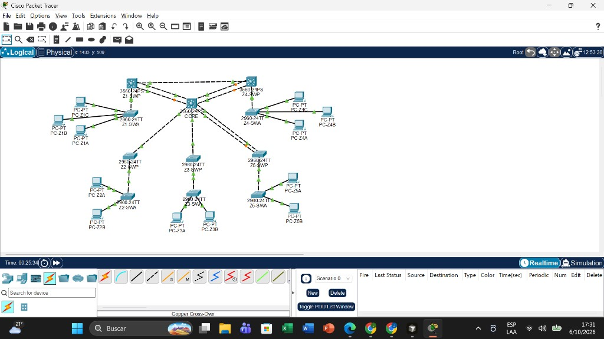
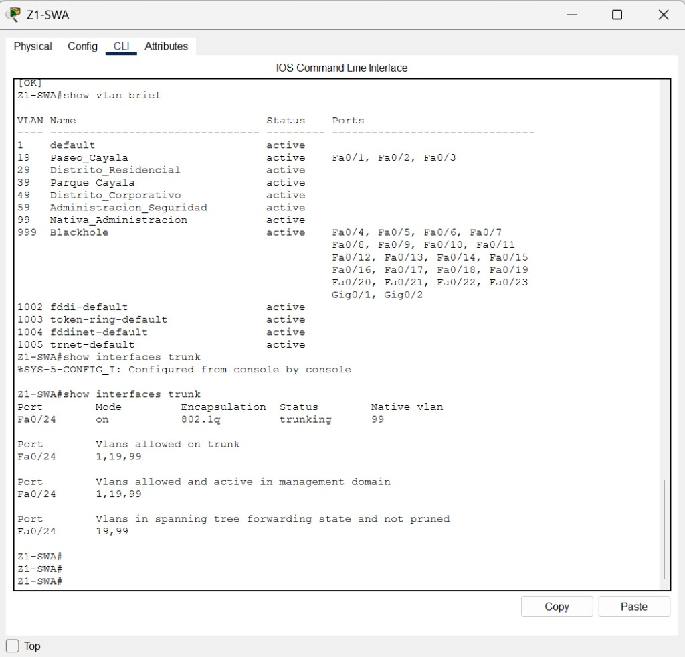
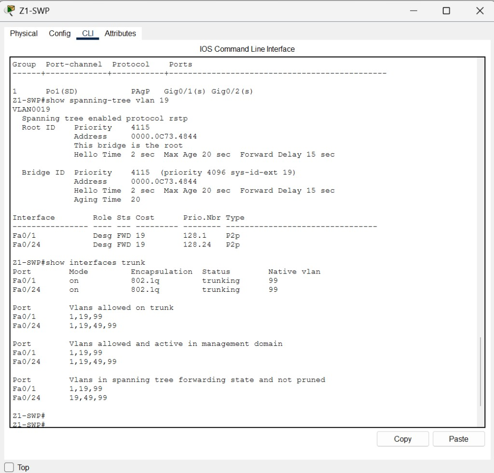
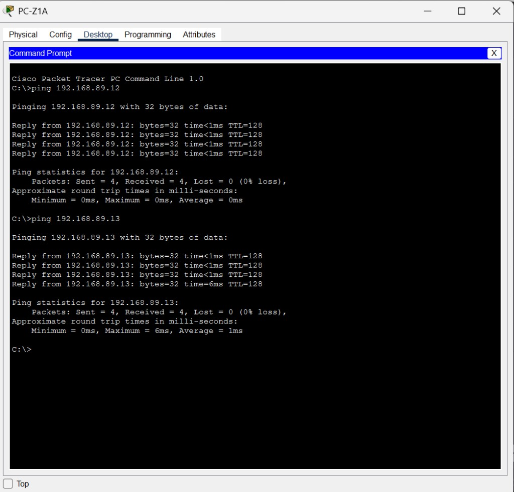

# Manual técnico — Red de la Ciudad Comercial Cayalá

**Estudiante:** Josue Daniel Herrera Cottom  
**Carné:** 202300689  
**Curso:** Redes de Computadoras 1 — FIUSAC — Segundo semestre 2026  
**Simulador:** Cisco Packet Tracer  
**Código CLI:** [codigo_fuente.md](codigo_fuente.md)  
**Informe:** [Informe_Desarrollo.md](Informe_Desarrollo.md)

---

## 1. Objetivo

Interconectar cinco zonas reales del complejo Cayalá con una red de capa 2. Cada zona queda en su propia VLAN. Los hosts de una misma zona se alcanzan entre sí. Los hosts de zonas distintas quedan aislados, aunque compartan la red 192.168.89.0/24.

La terminación de carné **9** fija los identificadores 19, 29, 39, 49 y 59, y obliga a negociar EtherChannel con **PAgP** (protocolo propietario de Cisco, usado cuando el último dígito es impar).

## 2. Zonas, rol y criticidad

El complejo no se diseñó con el mismo esquema en todas las zonas. El volumen de hosts del enunciado y la función real de cada lugar deciden cuántos enlaces tiene y si necesita agregación.

| Zona | Lugar real | VLAN | Hosts del enunciado | PCs en Packet Tracer | Criticidad | Esquema |
|------|------------|------|---------------------|----------------------|------------|---------|
| 1 | Paseo Cayalá | 19 | 60 | 3 | Crítica | Estrella interna y EtherChannel de 2 Gigabit hacia el núcleo |
| 2 | Distrito Residencial | 29 | 28 | 2 | Media | Estrella simple, un enlace hacia el núcleo |
| 3 | Parque Cayalá | 39 | 12 | 2 | Baja | Cadena: núcleo, switch principal, switch de acceso |
| 4 | Distrito Corporativo | 49 | 50 | 3 | Crítica | Estrella, dos enlaces hacia el núcleo y un enlace extra hacia la zona 1 |
| 5 | Administración y Seguridad | 59 | 7 | 2 | Crítica por función | Estrella y dos enlaces hacia el núcleo |

**Paseo Cayalá** es el corredor peatonal de tiendas y restaurantes. Concentra visitantes y el mayor número de hosts (60). Si pierde conectividad, se detiene la operación comercial del complejo. Por eso sus dos enlaces Gigabit se agrupan con PAgP: los dos quedan activos y suman capacidad.

**Distrito Residencial** atiende vivienda. El tráfico es de hogares. Una caída afecta a los residentes, pero no detiene el comercio ni la vigilancia del complejo. Un solo enlace hacia el núcleo es suficiente.

**Parque Cayalá** cubre áreas verdes, kioscos y acceso inalámbrico de visitantes. El uso es intermitente y el enunciado le asigna solo 12 hosts. Se conecta en cadena, sin enlace de respaldo.

**Distrito Corporativo** agrupa oficinas, bancos y empresas. Una caída interrumpe pagos y operación de negocios. Tiene dos cables físicos hacia el núcleo. Spanning Tree deja uno activo y el otro en reserva. Además existe un cable directo hacia el Paseo para que esas dos zonas críticas sigan unidas si el núcleo falla.

**Administración y Seguridad** tiene pocos hosts (cámaras, control de acceso y oficinas de la administración), pero su función es crítica: si se cae, el complejo pierde vigilancia. Lleva dos cables hacia el núcleo. No usa EtherChannel porque el volumen no lo justifica; la redundancia sí.

En el dibujo solo se colocaron 2 o 3 PCs por zona. Representan a los 60, 28, 12, 50 y 7 hosts del enunciado. Las VLAN y los enlaces se dimensionaron con esas cantidades reales.

## 3. Topología híbrida

La red combina tres esquemas. No es la misma figura repetida cinco veces.

1. **Estrella extendida.** CORE, un Cisco 3560, queda en el centro. El switch principal de cada zona se conecta a él por troncales.
2. **Malla parcial.** Z1-SWP FastEthernet0/24 se conecta a Z4-SWP FastEthernet0/22. Es el camino alterno entre Paseo Cayalá y el Distrito Corporativo.
3. **Cadena**, solo en el parque: CORE — Z3-SWP — Z3-SWA.

Dentro de cada zona, las PCs cuelgan en estrella del switch de acceso.



### Equipos

| Nombre | Modelo | Rol |
|--------|--------|-----|
| CORE | 3560-24PS | Núcleo. VTP transparente. Root de las VLAN 1 y 99. |
| Z1-SWP | 3560-24PS | Principal del Paseo. Servidor VTP. Root de la VLAN 19. |
| Z1-SWA | 2960-24TT | Acceso del Paseo. Cliente VTP. |
| Z2-SWP | 2960-24TT | Principal residencial. Servidor VTP. Root de la VLAN 29. |
| Z2-SWA | 2960-24TT | Acceso residencial. Cliente VTP. |
| Z3-SWP | 2960-24TT | Principal del parque. Servidor VTP. Root de la VLAN 39. |
| Z3-SWA | 2960-24TT | Acceso del parque. Cliente VTP. |
| Z4-SWP | 3560-24PS | Principal corporativo. Servidor VTP. Root de la VLAN 49. |
| Z4-SWA | 2960-24TT | Acceso corporativo. Cliente VTP. |
| Z5-SWP | 2960-24TT | Principal de administración. Servidor VTP. Root de la VLAN 59. |
| Z5-SWA | 2960-24TT | Acceso de administración. Cliente VTP. |

Se usan los dos modelos pedidos: 3560 en el núcleo y en las dos zonas de mayor peso (Paseo y Corporativo), y 2960 en el acceso y en las zonas de menor volumen.

### Cableado (TIA/EIA-568B)

- PC a switch: cable **recto** (straight-through).
- Switch a switch: cable **cruzado** (crossover).

| Enlace | Puertos | Cables | Motivo |
|--------|---------|--------|--------|
| Z1-SWP — CORE | Gi0/1 y Gi0/2 en ambos | 2 cruzados | EtherChannel PAgP del Paseo |
| Z2-SWP — CORE | Fa0/24 — Fa0/1 | 1 cruzado | Residencial, un solo camino |
| Z3-SWP — CORE | Fa0/24 — Fa0/2 | 1 cruzado | Parque, un solo camino |
| Z5-SWP — CORE | Fa0/23 — Fa0/3 y Fa0/24 — Fa0/4 | 2 cruzados | Respaldo de administración |
| Z4-SWP — CORE | Fa0/23 — Fa0/5 y Fa0/24 — Fa0/6 | 2 cruzados | Respaldo corporativo |
| Z1-SWP — Z4-SWP | Fa0/24 — Fa0/22 | 1 cruzado | Malla parcial entre zonas críticas |
| Principal — acceso | Fa0/1 — Fa0/24 de cada par | 1 cruzado por zona | Subida de las PCs |
| PC — acceso | Fa0/1, Fa0/2 y, si hay tres PCs, Fa0/3 | Recto | Hosts |

Un puntito naranja en un enlace doble es Spanning Tree bloqueando el camino de reserva. No se borra.

## 4. Tabla de VLANs

| VLAN | Nombre | Uso | Dónde hay hosts |
|------|--------|-----|-----------------|
| 1 | default | Solo transporte de anuncios VTP. Sin PCs. | Ninguno |
| 19 | Paseo_Cayala | Zona 1 | PC-Z1A, PC-Z1B, PC-Z1C |
| 29 | Distrito_Residencial | Zona 2 | PC-Z2A, PC-Z2B |
| 39 | Parque_Cayala | Zona 3 | PC-Z3A, PC-Z3B |
| 49 | Distrito_Corporativo | Zona 4 | PC-Z4A, PC-Z4B, PC-Z4C |
| 59 | Administracion_Seguridad | Zona 5 | PC-Z5A, PC-Z5B |
| 99 | Nativa_Administracion | VLAN nativa y administración de switches | SVI de los principales y de CORE |
| 999 | Blackhole | Puertos no usados, apagados | Ninguno |

Los troncales permiten solo las VLANs que ese enlace necesita, más la VLAN 1 (VTP) y la 99 (nativa). La 999 no viaja entre switches.

| Troncal | VLANs permitidas |
|---------|------------------|
| CORE Fa0/1 hacia zona 2 | 1, 29, 99 |
| CORE Fa0/2 hacia zona 3 | 1, 39, 99 |
| CORE Fa0/3 y Fa0/4 hacia zona 5 | 1, 59, 99 |
| CORE Fa0/5 y Fa0/6 hacia zona 4 | 1, 49, 99 |
| EtherChannel CORE — Z1-SWP | 1, 19, 99 |
| Z1-SWP Fa0/24 — Z4-SWP Fa0/22 | 1, 19, 49, 99 |
| Cada principal hacia su acceso | 1, VLAN de esa zona, 99 |

La nativa de todos los troncales es la **99**. Así el tráfico de administración no queda en la VLAN 1, que es la nativa de fábrica.

## 5. Direccionamiento

Todas las PCs están en **192.168.89.0/24**. El 89 sale de los dos últimos dígitos del carné. Máscara **255.255.255.0**. Puerta de enlace **192.168.89.1** (SVI de CORE en la VLAN 99).

| Equipo | VLAN | Dirección |
|--------|------|-----------|
| CORE (VLAN 99) | 99 | 192.168.89.1 |
| Z1-SWP | 99 | 192.168.89.2 |
| Z2-SWP | 99 | 192.168.89.3 |
| Z3-SWP | 99 | 192.168.89.4 |
| Z4-SWP | 99 | 192.168.89.5 |
| Z5-SWP | 99 | 192.168.89.6 |
| PC-Z1A | 19 | 192.168.89.11 |
| PC-Z1B | 19 | 192.168.89.12 |
| PC-Z1C | 19 | 192.168.89.13 |
| PC-Z2A | 29 | 192.168.89.21 |
| PC-Z2B | 29 | 192.168.89.22 |
| PC-Z3A | 39 | 192.168.89.31 |
| PC-Z3B | 39 | 192.168.89.32 |
| PC-Z4A | 49 | 192.168.89.41 |
| PC-Z4B | 49 | 192.168.89.42 |
| PC-Z4C | 49 | 192.168.89.43 |
| PC-Z5A | 59 | 192.168.89.51 |
| PC-Z5B | 59 | 192.168.89.52 |

Un ping entre dos PCs de la misma VLAN no usa la puerta de enlace: las dos están en la misma red y el switch entrega la trama. Un ping hacia otra VLAN no tiene ruta de capa 3 entre ellas. CORE solo tiene una interfaz de capa 3, la VLAN 99, en esa misma red. Por eso `show ip route` muestra una sola red conectada y el ping entre zonas se agota. Ese aislamiento es el resultado pedido para la capa 2.


## 6. VTP

| Parámetro | Valor |
|-----------|--------|
| Dominio | 202300689 |
| Contraseña | cisco123 |
| Versión | 2 |
| Servidores | Z1-SWP, Z2-SWP, Z3-SWP, Z4-SWP, Z5-SWP |
| Clientes | Z1-SWA, Z2-SWA, Z3-SWA, Z4-SWA, Z5-SWA |
| Transparente | CORE |

CORE es transparente para no competir por la base de datos de VLANs y, aun así, reenviar los anuncios. En un switch transparente las VLANs se crean a mano. En los clientes no se crean: las aprenden del servidor de su zona. La evidencia está en Z1-SWA, donde Fa0/1–Fa0/3 quedaron en la VLAN 19 aprendida por VTP.



## 7. Rapid PVST+ y root bridge

Todos los switches usan `spanning-tree mode rapid-pvst`. Cada principal es root solo de la VLAN de su zona, con prioridad **4096**. CORE es root de la VLAN 99 y de la VLAN 1, también con 4096, y queda como root de respaldo de las VLANs de usuario con prioridad **8192**. La prioridad configurada se suma al número de VLAN en el Bridge ID (por ejemplo, 4096 + 19 = 4115).

| VLAN | Root | Prioridad configurada | Por qué ese switch |
|------|------|------------------------|--------------------|
| 1 | CORE | 4096 | El centro debe gobernar la VLAN que transporta VTP. |
| 19 | Z1-SWP | 4096 | El Paseo es quien origina ese tráfico. |
| 29 | Z2-SWP | 4096 | El residencial origina la VLAN 29. |
| 39 | Z3-SWP | 4096 | El parque origina la VLAN 39. |
| 49 | Z4-SWP | 4096 | El corporativo origina la VLAN 49. |
| 59 | Z5-SWP | 4096 | Administración origina la VLAN 59. |
| 99 | CORE | 4096 | La administración de los switches converge en el núcleo. |
| 19, 29, 39, 49, 59 | CORE como respaldo | 8192 | Si cae el principal de una zona, el núcleo asume esa VLAN. |



En los enlaces dobles de las zonas 4 y 5, Rapid PVST+ deja un puerto reenviando y el otro bloqueado para la VLAN en la que ese switch no es root. En la VLAN propia del principal, sus puertos designados reenvían; el bloqueo del camino sobrante aparece en el otro extremo (CORE).

## 8. EtherChannel con PAgP

El carné termina en 9, impar, así que el protocolo es PAgP y no LACP. Se aplicó entre **Z1-SWP** y **CORE**, los dos enlaces GigabitEthernet0/1 y GigabitEthernet0/2, grupo 1, modo `desirable` en ambos lados.

Esa zona es la de mayor tráfico del enunciado (60 hosts, comercio continuo). Agrupar los dos cables deja los dos activos: hay más capacidad y, si uno se corta, el otro sigue dentro del mismo canal. En el corporativo y en administración el requisito era disponibilidad, no más ancho de banda, y por eso ahí los dos cables quedan separados para que Spanning Tree elija el de reserva.

El resultado verificado es `Po1(SU)`, protocolo **PAgP**, y `Gig0/1(P) Gig0/2(P)`.


## 9. Dominios de colisión y de broadcast

Cada puerto de switch en full dúplex cierra un dominio de colisión. Un hub habría metido a todos los hosts de una zona en un solo dominio; aquí cada enlace es independiente. Eso conviene en Cayalá porque el Paseo y el corporativo concentran muchos equipos y no deben competir por el mismo medio.

Hay **26 dominios de colisión**, uno por cada cable activo:

- 12 cables de PC a switch de acceso.
- 5 cables de switch principal a switch de acceso.
- 6 cables de los principales hacia CORE (1 del residencial, 1 del parque, 2 de administración y 2 del corporativo).
- 2 cables Gigabit del EtherChannel.
- 1 cable de la malla entre zona 1 y zona 4.

Los dominios de broadcast los marcan las VLANs, no los switches:

- **5 dominios de usuarios**, uno por zona (VLAN 19, 29, 39, 49 y 59). Un broadcast de una PC del Paseo no sale de la VLAN 19.
- **1 dominio de administración**, la VLAN 99, compartido por las SVI de los switches.
- La VLAN 999 no forma un dominio activo: sus puertos están en `shutdown`.
- La VLAN 1 no tiene hosts. Solo permite que VTP viaje por los troncales.

Esa separación es la adecuada: el comercio, la vivienda, el parque, las oficinas y la seguridad no comparten tormentas de broadcast, y los puertos vacíos no pueden usarse para entrar a una VLAN de producción.

## 10. Pruebas

Se exigían al menos 10 pings exitosos dentro de cada zona y aislamiento entre VLANs. Los diez de la misma zona respondieron con 0 % de pérdida. Tres pings entre zonas distintas terminaron en `Request timed out` con 100 % de pérdida.

| Origen | Destino | Resultado |
|--------|---------|-----------|
| PC-Z1A → 192.168.89.12 y .13 | Misma VLAN 19 | Reply, 0 % de pérdida |
| PC-Z1B → 192.168.89.13 | Misma VLAN 19 | Reply, 0 % de pérdida |
| PC-Z2A → 192.168.89.22 y el regreso | Misma VLAN 29 | Reply, 0 % de pérdida |
| PC-Z3A → 192.168.89.32 | Misma VLAN 39 | Reply, 0 % de pérdida |
| PC-Z4A → 192.168.89.42 y .43 | Misma VLAN 49 | Reply, 0 % de pérdida |
| PC-Z4B → 192.168.89.43 | Misma VLAN 49 | Reply, 0 % de pérdida |
| PC-Z5A → 192.168.89.52 | Misma VLAN 59 | Reply, 0 % de pérdida |
| PC-Z1A → 192.168.89.21 y .41 | Otras VLANs | Timeout, 100 % de pérdida |
| PC-Z4A → 192.168.89.51 | Otra VLAN | Timeout, 100 % de pérdida |




En CORE, `show ip route` muestra:

```text
C    192.168.89.0/24 is directly connected, Vlan99
```

No hay rutas hacia otras redes porque la práctica mantiene un solo prefijo y la separación se hace en capa 2.

## 11. Conclusión

La red deja a cada zona de Cayalá en su VLAN, con el switch principal como servidor VTP y root de esa VLAN. El núcleo concentra la administración. El Paseo, por ser la zona de más hosts, agrega sus dos enlaces con PAgP. El corporativo y la administración conservan un segundo cable de reserva. El parque y el residencial no pagan el costo de una redundancia que su función no exige. Los pings confirman alcance dentro de la zona y aislamiento entre zonas.
