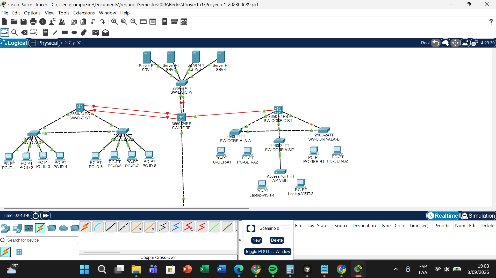
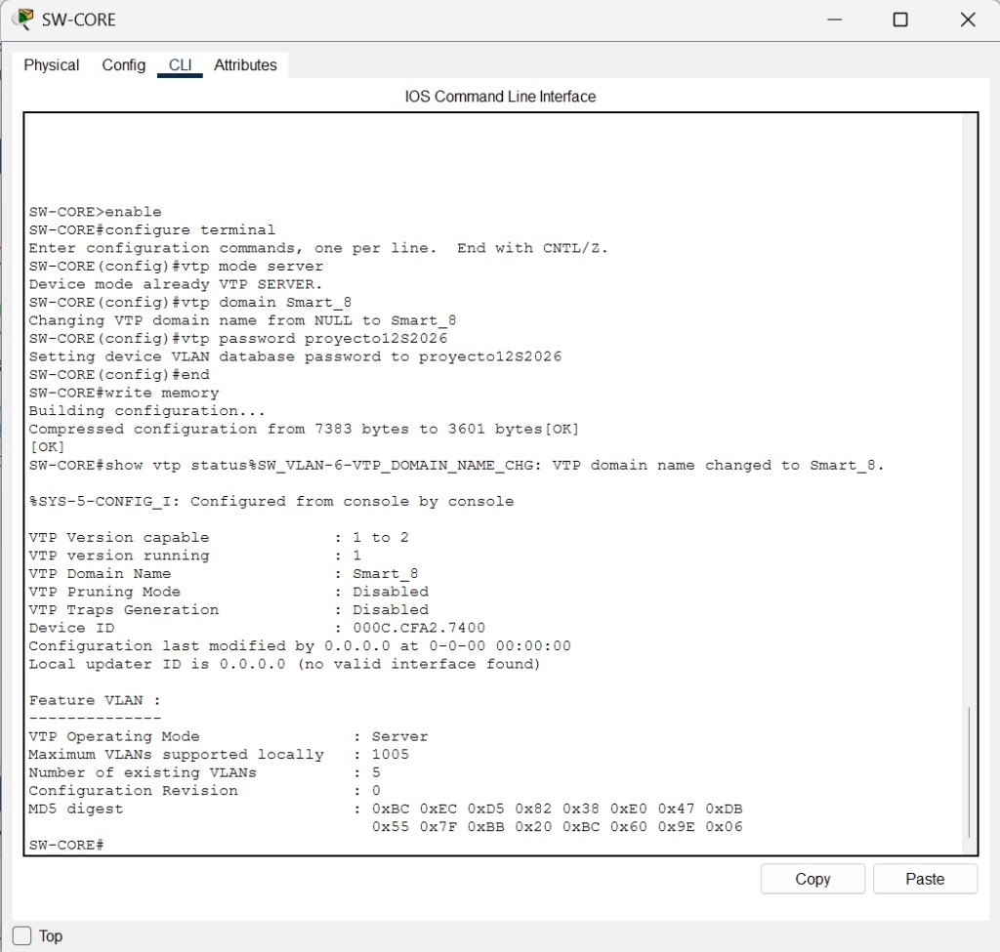
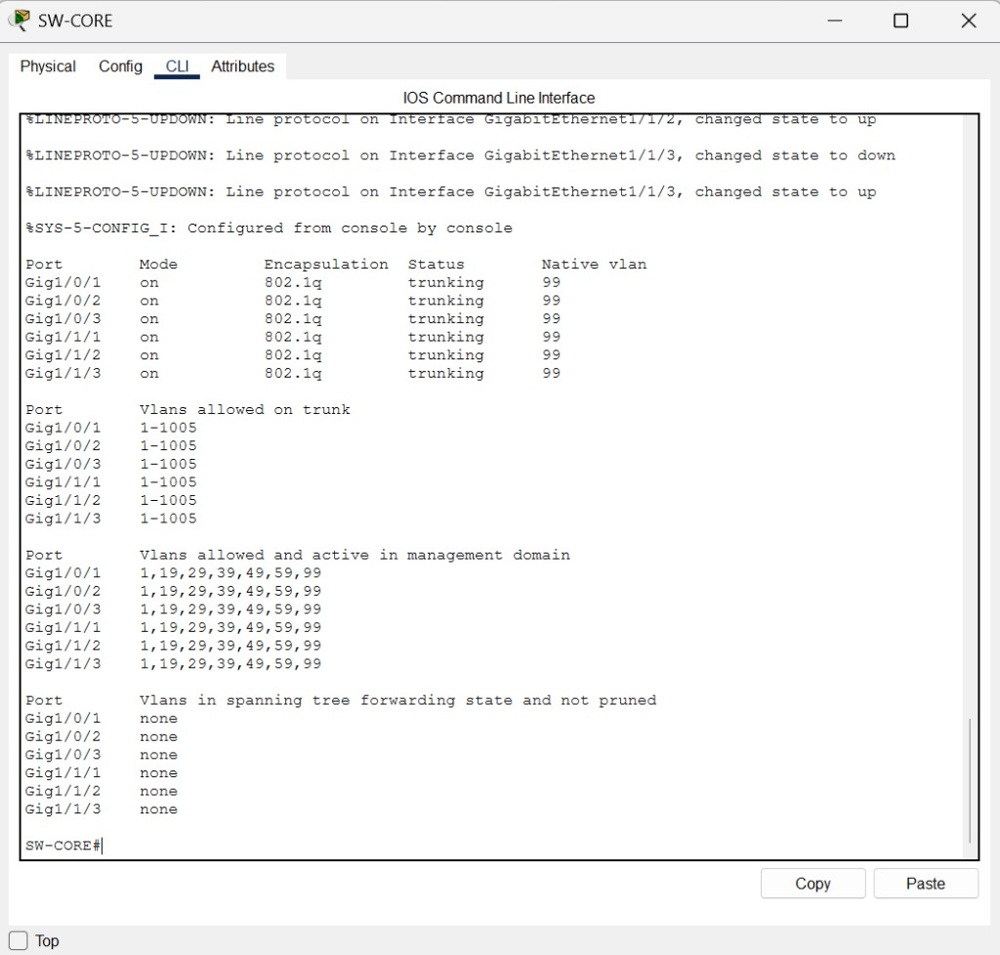
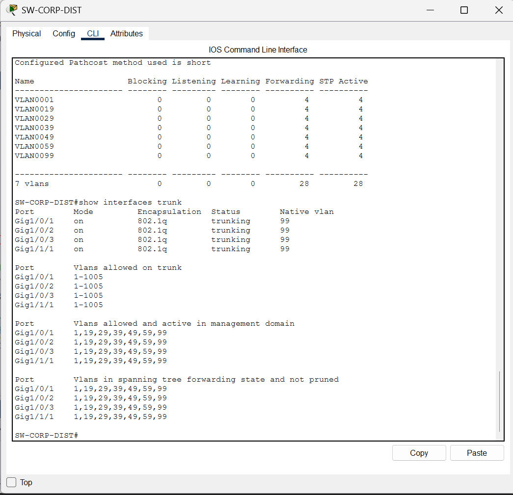
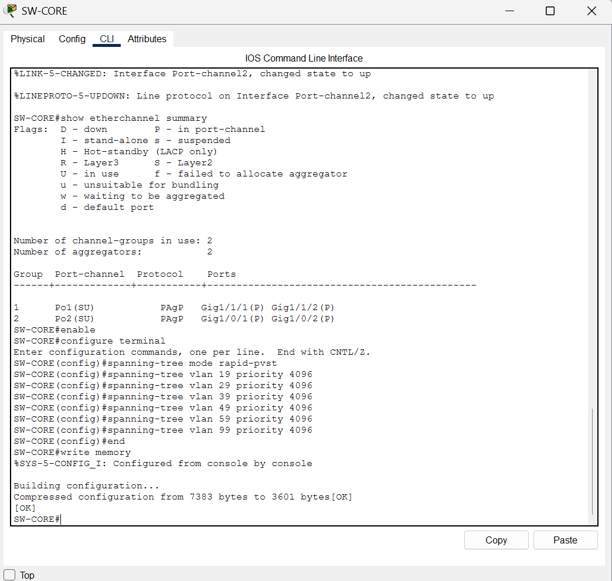
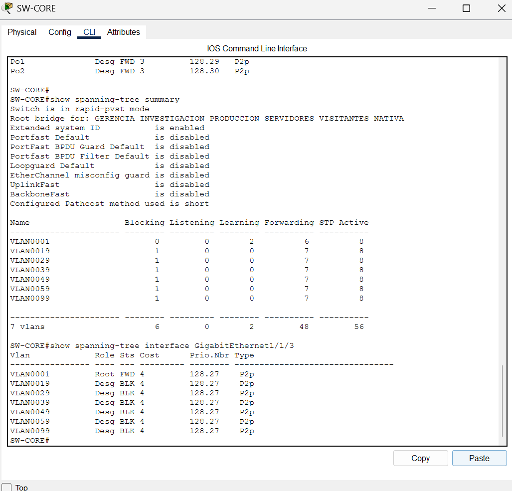
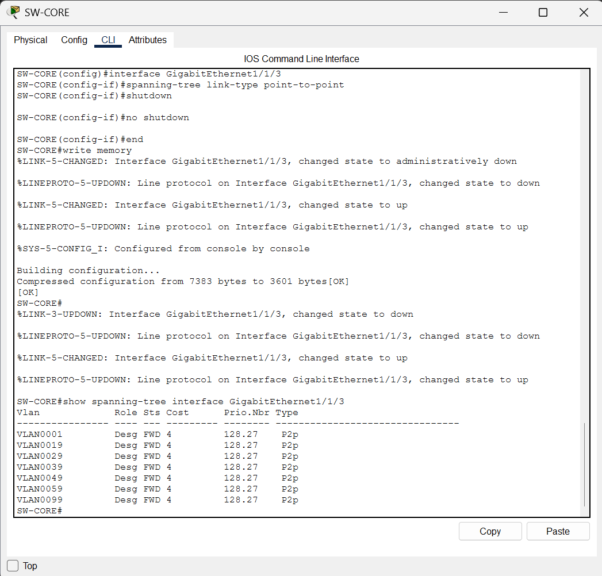
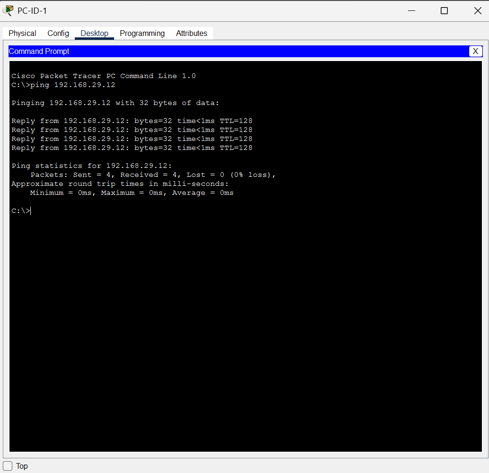
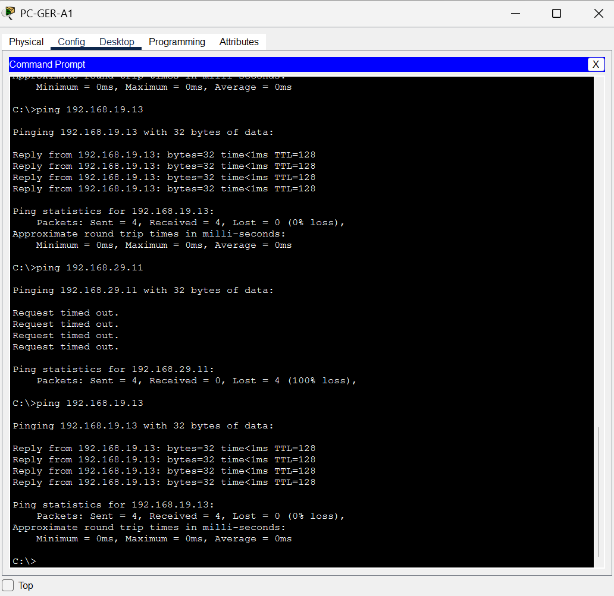

# Universidad de San Carlos de Guatemala

## Facultad de Ingeniería — Escuela de Ingeniería en Ciencias y Sistemas

# Manual Técnico — Proyecto 1: SmartCity Tech Park

Este `README.md` es el **Manual Técnico completo** del Proyecto 1 (Capa 1 y Capa 2), conforme al enunciado oficial.

| Dato | Valor |
| --- | --- |
| Curso | Redes de Computadoras 1 |
| Proyecto | Proyecto 1 — SmartCity Tech Park (Capa 1 y Capa 2) |
| Estudiante | Josue Daniel Herrera Cottom |
| Carné | 202300689 |
| Compañero (parte física) | Oscar Danilo Melendrez Marroquin — 202308486 |
| Packet Tracer | 9.0.1.0858 |
| Repositorio | [Redes1_2S_2026_202300689](https://github.com/JosueDanielHC/Redes1_2S_2026_202300689) |
| Archivo de simulación | [`Proyecto1_202300689.pkt`](Proyecto1_202300689.pkt) |
| Semestre | Segundo semestre 2026 |

Otros entregables del curso en este repositorio: [`Practica1/`](Practica1/) · [`Tarea 3/`](Tarea%203/) · [`Proyecto1/`](Proyecto1/).

---

## 1. Introducción

SmartCity Tech Park requiere una red de campus con diseño jerárquico, VLANs por función, VTP, trunks con VLAN nativa distinta de 1, EtherChannel, STP y un segmento Legacy con Hub. Este documento describe la topología implementada en Cisco Packet Tracer, las decisiones de diseño, las pruebas ejecutadas y el presupuesto estimado del equipo simulado.

## 2. Objetivo

Diseñar, configurar y verificar una red de Capa 1 y Capa 2 que cumpla el enunciado oficial: cuatro zonas (Centro de Datos, I+D, Corporativo, Planta de Producción), aislamiento entre VLANs, redundancia demostrable y evidencias de `show` y ping.

## 3. Descripción del problema

El parque tecnológico concentra investigación, gerencia, visitantes inalámbricos, granja de servidores y máquinas industriales antiguas. Hay que unir esos segmentos sin mezclar dominios de broadcast, sin usar VLAN 1 como nativa, y con alta disponibilidad en I+D, Corporativo y la granja.

## 4. Parámetros del carné (verificados dos veces)

Carnet **202300689** (impar). Último dígito **X = 9**. Penúltimo **# = 8**.

| Parámetro | Valor |
| --- | --- |
| VLAN Gerencia | **19** GERENCIA |
| VLAN Investigación | **29** INVESTIGACION |
| VLAN Producción | **39** PRODUCCION |
| VLAN Servidores | **49** SERVIDORES |
| VLAN Visitantes | **59** VISITANTES |
| VLAN nativa | **99** NATIVA |
| Dominio VTP | `Smart_8` |
| Password VTP | `proyecto12S2026` |
| EtherChannel | **PAgP** (`desirable`) |
| STP | **Rapid-PVST** |
| Banner (distribución) | `Acceso Restringido - TechPark_202300689` |

## 5. Arquitectura jerárquica

- **Core:** `SW-CORE` (Catalyst 3650-24PS) en el Centro de Datos. VTP Server y Root Bridge.
- **Distribución:** `SW-ID-DIST`, `SW-CORP-DIST` (3650-24PS) y `SW-PROD-DIST` (2960-24TT).
- **Acceso:** switches 2960-24TT por ala/área, granja `SW-DC-SRV`, visitantes `SW-CORP-VISIT` (VTP Transparent).

No hay routers: el alcance del proyecto es Capa 1 y 2. El aislamiento inter-VLAN se demuestra **sin enrutamiento**.

## 6. Topología

```text
                         SRV1 SRV2 SRV3 SRV4
                                |
                           SW-DC-SRV
                          Po2 (PAgP 2x cobre)
                                |
                            SW-CORE
                     /          |          \
              Po1 2x fibra    1x fibra    1x cobre
                 /              |            \
          SW-ID-DIST      SW-CORP-DIST    SW-PROD-DIST
           /      \        /    |    \           |
     ACC1        ACC2  ALA-A  ALA-B  VISIT      HUB
     4 PC        4 PC   2 PC   2 PC   AP+2 LT   2 PC IND
           \    /               \    /
          trunk triángulo    trunk entre alas
```



## 7. Inventario de dispositivos

| Nombre | Modelo PT | Función |
| --- | --- | --- |
| SW-CORE | 3650-24PS | Core, VTP Server, Root |
| SW-DC-SRV | 2960-24TT | Acceso granja |
| SW-ID-DIST | 3650-24PS | Distribución I+D |
| SW-ID-ACC1 / ACC2 | 2960-24TT | Acceso I+D (triángulo) |
| SW-CORP-DIST | 3650-24PS | Distribución Corporativo |
| SW-CORP-ALA-A / ALA-B | 2960-24TT | Acceso gerencia por ala |
| SW-CORP-VISIT | 2960-24TT | Acceso visitantes (VTP Transparent) |
| SW-PROD-DIST | 2960-24TT | Acceso/distribución Producción |
| HUB-LEGACY | Hub-PT | Dominio de colisión compartido |
| AP-VISIT | AccessPoint-PT | WiFi VLAN 59 |
| SRV1–SRV4 | Server-PT | Granja VLAN 49 |
| PC-ID-1 a 8 | PC-PT | I+D VLAN 29 |
| PC-GER-A1/A2, B1/B2 | PC-PT | Gerencia VLAN 19 |
| PC-IND-1/2 | PC-PT | Industrial VLAN 39 |
| Laptop-VISIT-1/2 | host + `PT-HOST-NM-1W` | Visitantes VLAN 59 |

## 8. Tabla de VLAN y dispositivos

| VLAN | Nombre | Ubicación | Dispositivos |
| ---: | --- | --- | --- |
| 19 | GERENCIA | Alas A y B | PC-GER-A1, A2, B1, B2 |
| 29 | INVESTIGACION | I+D ACC1 y ACC2 | PC-ID-1 … PC-ID-8 |
| 39 | PRODUCCION | Hub Legacy | PC-IND-1, PC-IND-2 |
| 49 | SERVIDORES | Granja | SRV1 … SRV4 |
| 59 | VISITANTES | AP-VISIT | Laptop-VISIT-1, Laptop-VISIT-2 |
| 99 | NATIVA | Todos los trunks | sin hosts |

## 9. Direccionamiento (solo para pruebas L2)

Máscara `255.255.255.0`. Gateway vacío a propósito: no hay ruteo inter-VLAN.

| VLAN | Red | Hosts |
| ---: | --- | --- |
| 19 | 192.168.19.0/24 | A1 `.11` A2 `.12` B1 `.13` B2 `.14` |
| 29 | 192.168.29.0/24 | PC-ID-1 `.11` … PC-ID-8 `.18` |
| 39 | 192.168.39.0/24 | IND-1 `.11` IND-2 `.12` |
| 49 | 192.168.49.0/24 | SRV1 `.11` … SRV4 `.14` |
| 59 | 192.168.59.0/24 | Laptop-1 `.11` Laptop-2 `.12` |

SSID visitantes (decisión de diseño): `VISITANTES`, WPA2-PSK, clave `Visitantes2026`.

## 10. VTP

| Switch | Modo | Justificación |
| --- | --- | --- |
| SW-CORE | Server | El Core administra el dominio; único punto de creación de VLAN |
| Resto (excepto VISIT) | Client | Reciben VLAN 19/29/39/49/59/99 |
| SW-CORP-VISIT | Transparent | Visitantes aislados: no aceptan el catálogo VTP; VLAN 59 y 99 se crearon **en local** |

Dominio `Smart_8`, password `proyecto12S2026`. Tras los trunks, los Client subieron revision (evidencia: revisión 12 en distribución).



## 11. Trunks y VLAN nativa

Todos los enlaces switch–switch son trunk 802.1q con **native VLAN 99** (nunca VLAN 1).

| Origen | Destino | Medio |
| --- | --- | --- |
| CORE Gi1/1/1-2 | ID-DIST Gi1/1/1-2 | Fibra SM (Po1) |
| CORE Gi1/1/3 | CORP-DIST Gi1/1/1 | Fibra SM |
| CORE Gi1/0/1-2 | DC-SRV Gi0/1-2 | Cobre (Po2) |
| CORE Gi1/0/3 | PROD-DIST | Cobre |
| ID-DIST | ACC1, ACC2 | Cobre |
| ACC1 | ACC2 | Cobre (triángulo) |
| CORP-DIST | ALA-A, ALA-B, VISIT | Cobre |
| ALA-A | ALA-B | Cobre (redundancia) |

SFP utilizados: **GLC-LH-SMD** (3 en Core, 2 en ID-DIST, 1 en CORP-DIST).





## 12. EtherChannel (PAgP)

Carnet impar → PAgP, modo `desirable` en ambos extremos.

| ID | Enlaces | Estado verificado |
| --- | --- | --- |
| Po1 | CORE ↔ ID-DIST, 2× fibra | `Po1(SU)`, puertos `(P)`, protocolo PAgP |
| Po2 | CORE ↔ DC-SRV, 2× cobre | `Po2(SU)`, puertos `(P)`, protocolo PAgP |

Los Port-channel del 3650 nacieron como L3: se aplicó `switchport` + nativa 99 para que el bundle subiera.



## 13. STP y Root Bridge

Protocolo: **Rapid-PVST**.

| VLAN | Root | Prioridad | Secundario | Prioridad |
| ---: | --- | ---: | --- | ---: |
| 19 | SW-CORE | 4096 | SW-CORP-DIST | 8192 |
| 29 | SW-CORE | 4096 | SW-ID-DIST | 8192 |
| 39 | SW-CORE | 4096 | SW-PROD-DIST | 8192 |
| 49 | SW-CORE | 4096 | SW-DC-SRV | 8192 |
| 59 | SW-CORE | 4096 | SW-CORP-DIST | 8192 |
| 99 | SW-CORE | 4096 | SW-ID-DIST | 8192 |
| 1 | SW-CORE | 4096 | — | — |

VLAN 1 no se usa para hosts; se unificó el Root en el Core para que el uplink de Corporativo (`Gi1/1/3`) no quedara como Root Port de VLAN 1 y Designated Blocking en el resto. Tras `link-type point-to-point` y recarga del puerto, `Gi1/1/3` quedó **Desg FWD** en todas las VLAN.

Los naranjas del triángulo I+D y de las alas son puertos Alternate/Backup de STP. **No se eliminan.**





## 14. Redundancia (pruebas reales)

| Prueba | Acción | Resultado |
| --- | --- | --- |
| I+D | `shutdown` Gi0/1 de SW-ID-ACC1 | Ping PC-ID-1 → 192.168.29.15 **siguió OK** |
| Corporativo | `shutdown` Gi0/1 de SW-CORP-ALA-A | Ping PC-GER-A1 → 192.168.19.13 **siguió OK** |
| Granja | Po2 con 2 miembros | Los servidores no dependen de un solo cobre |

Enlaces restaurados con `no shutdown` y `write memory`.

## 15. Segmento Legacy

`PC-IND-1/2` → `HUB-LEGACY` → `SW-PROD-DIST` Fa0/1 (access VLAN 39).

Impacto: un solo dominio de colisión; si IND-1 transmite, IND-2 y el puerto del switch compiten por el medio (CSMA/CD). El switch **contiene** el dominio hacia el resto de la red (no inunda colisiones al Core), pero **no elimina** el segmento Legacy: el Hub sigue siendo compartido entre las máquinas industriales.

## 16. Dominios de colisión

Cálculo según topología final (1 dominio por puerto de switch full-duplex activo). El Hub es la excepción.

| Dispositivo | Puertos activos | Dominios de colisión |
| --- | ---: | ---: |
| SW-CORE | 6 | 6 |
| SW-DC-SRV | 6 | 6 |
| SW-ID-DIST | 4 | 4 |
| SW-ID-ACC1 | 6 | 6 |
| SW-ID-ACC2 | 6 | 6 |
| SW-CORP-DIST | 4 | 4 |
| SW-CORP-ALA-A | 4 | 4 |
| SW-CORP-ALA-B | 4 | 4 |
| SW-CORP-VISIT | 2 | 2 |
| SW-PROD-DIST | 1 (uplink al Core) | 1 |
| HUB-LEGACY | 3 (switch + 2 PC) | **1 compartido** |

`Fa0/1` de Producción pertenece al dominio del Hub, no suma uno extra.

## 17. Dominios de broadcast

Una VLAN activa = un dominio de broadcast.

| VLAN | Nombre | Dominios |
| ---: | --- | ---: |
| 19 | GERENCIA | 1 |
| 29 | INVESTIGACION | 1 |
| 39 | PRODUCCION | 1 |
| 49 | SERVIDORES | 1 |
| 59 | VISITANTES | 1 |
| 99 | NATIVA | 1 |

VLAN 1 existe en los switches (puertos vacíos) pero **no transporta hosts del proyecto**.

## 18. Medios de transmisión

| Enlace | Medio | Justificación |
| --- | --- | --- |
| Core ↔ I+D (alta demanda, 8 PCs + investigación) | Fibra SM + GLC-LH-SMD, EtherChannel 2 enlaces | Distancia entre edificios, EMI, mayor ancho de banda |
| Core ↔ Corporativo | Fibra SM (1 enlace) | Distancia edificio–Core; demanda menor que I+D |
| Core ↔ Producción | Cobre UTP | Planta más cercana al Data Center; menor costo; Hub a 100 Mb |
| Core ↔ granja | Cobre + EtherChannel | Mismos rack/cuarto; alta capacidad sin fibra |
| Acceso (PC, AP, Hub) | UTP straight-through | Horizontal < 100 m |
| Switch–switch cobre | UTP crossover (PT) | Enlaces entre dispositivos activos |

## 19. Pruebas de conectividad (ejecutadas)

| Origen | Destino | Esperado | Real | Evidencia |
| --- | --- | --- | --- | --- |
| PC-ID-1 | PC-ID-2 (`.12`) | OK | OK 0% pérdida | [`44_ping_id_intra_vlan.png`](Proyecto1/evidencias/conectividad/44_ping_id_intra_vlan.png) |
| PC-ID-1 | PC-ID-5 (`.15`) ACC2 | OK | OK 0% pérdida | [`53_ping_id_acc1_acc2.png`](Proyecto1/evidencias/conectividad/53_ping_id_acc1_acc2.png) |
| PC-GER-A1 | A2 (`.12`) | OK | OK | [`46_ping_gerencia_ala_a.png`](Proyecto1/evidencias/conectividad/46_ping_gerencia_ala_a.png) |
| PC-GER-A1 | B1 (`.13`) | OK | OK | [`47_ping_gerencia_entre_alas_y_fallo_intervlan.png`](Proyecto1/evidencias/conectividad/47_ping_gerencia_entre_alas_y_fallo_intervlan.png) |
| SRV1 | SRV2 (`.12`) | OK | OK | [`49_ping_servidores.png`](Proyecto1/evidencias/conectividad/49_ping_servidores.png) |
| PC-IND-1 | PC-IND-2 (`.12`) | OK | OK | [`50_ping_produccion_legacy.png`](Proyecto1/evidencias/conectividad/50_ping_produccion_legacy.png) |
| Laptop-VISIT-1 | Laptop-2 (`.12`) | OK | OK | [`51_ping_visitantes_ok_y_fallo_a_gerencia.png`](Proyecto1/evidencias/conectividad/51_ping_visitantes_ok_y_fallo_a_gerencia.png) |
| PC-GER-A1 | PC-ID-1 (`.11`) | Falla | Timeout 100% | misma captura 47 / 55 |
| Laptop-VISIT-1 | PC-GER-A1 | Falla | Timeout 100% | misma captura 51 |
| PC-ID-1 | `.15` con uplink ACC1 down | OK | OK | [`54_ping_redundancia_id.png`](Proyecto1/evidencias/conectividad/54_ping_redundancia_id.png) |
| PC-GER-A1 | `.13` con uplink Ala A down | OK | OK | [`55_ping_redundancia_corp.png`](Proyecto1/evidencias/conectividad/55_ping_redundancia_corp.png) |





## 20. Decisiones de diseño

| Decisión | Alternativas | Elegida | Justificación |
| --- | --- | --- | --- |
| Root Bridge | Dist por VLAN / Core único | Core prioridad 4096 | El tráfico de los tres edificios converge ahí; fácil de defender |
| EtherChannel | LACP vs PAgP | PAgP | Carné impar (PDF) |
| STP | PVST vs Rapid-PVST | Rapid-PVST | Carné impar (PDF) |
| VTP Transparent | Todos Client | Solo VISIT | Aisla el catálogo de visitantes |
| Medio Core–I+D | Cobre vs fibra | Fibra + Po1 | Mayor demanda y distancia |
| Medio Core–Corp | 2 fibras vs 1 | 1 fibra | Demanda menor que I+D |
| Medio Core–Prod | Fibra vs cobre | Cobre | Cercanía y Legacy a 100 Mb |
| I+D | Anillo vs triángulo | Triángulo 3 SW | Caída de un switch no aísla a los otros |
| Corporativo | Un switch vs 2 alas | 2 alas + enlace A–B | Redundancia si cae el uplink de un ala |
| WiFi | Abierto vs WPA2 | WPA2-PSK `Visitantes2026` | Demostrable y documentable |

## 21. Presupuesto estimado

Precios de **mercado refurbished / plaza Guatemala** consultados el 8-sep-2026. No son lista Cisco nueva. Tipo de cambio referencial usado solo para totalizar: **Q7.75 / USD**.

| Ítem | Cant. | Precio unit. | Fuente | Subtotal |
| --- | ---: | --- | --- | --- |
| Catalyst 3650-24PS (refurb.) | 3 | USD 125 | [ORMSystems WS-C3650-24PS-S](https://ormsystems.com/ws-c3650-24ps-s-price.html) | USD 375 |
| Catalyst 2960-24TT (refurb.) | 7 | USD 125 | [Network Outlet WS-C2960-24TT-L](https://networkoutlet.com/products/ws-c2960-24tt-l-cisco-catalyst-2960-24-10-100-2ge-lan) | USD 875 |
| GLC-LH-SMD (refurb.) | 6 | USD 78 | [ORMSystems GLC-LH-SMD](https://ormsystems.com/glc-lh-smd-price.html) | USD 468 |
| Cisco Business 240AC AP | 1 | Q 1,890 | [Pacifiko](https://www.pacifiko.com/cisco-designed) | ≈ USD 244 |
| UTP Cat6 (caja 305 m) | 1 | Q 1,498 | [Kemik Guatemala](https://www.kemik.gt/hikvision-cable-de-red-utp-cat-6-305-m-cobre-solido-23awg-alto-rendimiento) | ≈ USD 193 |
| Hub 8 puertos (Legacy, mercado usado) | 1 | USD 25 | Referencial (equipo descatalogado) | USD 25 |

**Total aproximado: USD 2,180 (≈ Q 16,900).** No incluye PCs, servidores ni manodobra. Los jumpers de fibra SM se cubren con la caja de UTP + patch de SM no cotizado en plaza al momento de la consulta (quedan como línea a cotizar con el proveedor de óptica).

## 22. Resultados

- VTP propaga las VLAN del carné desde el Core.
- Trunks nativa 99. EtherChannel PAgP Po1 y Po2 en `SU`.
- Rapid-PVST con Root en SW-CORE.
- Ping intra-VLAN correcto; ping inter-VLAN fallido (aislamiento).
- Redundancia I+D y Corporativo comprobada apagando un uplink.
- Legacy con Hub operativo en VLAN 39.

La inspección de BPDU/VTP en modo Simulation del PDF es **opcional** y no forma parte de esta entrega.

## 23. Conclusiones

La red cumple Capa 1 y 2 del SmartCity Tech Park: jerarquía, VLAN por función, nativa 99, PAgP y Rapid-PVST según carné impar, visitantes fuera de VTP Server/Client, y un Legacy que se documenta en lugar de esconderse. El siguiente paso de curso es la implementación física con dos switches (VTP Server + Client). Guía: [`Proyecto1/documentacion/laboratorio_fisico.md`](Proyecto1/documentacion/laboratorio_fisico.md).

## 24. Evidencias incluidas

Capturas en [`Proyecto1/evidencias/`](Proyecto1/evidencias/):

| Archivo | Qué demuestra |
| --- | --- |
| `topologia/00_topologia_final.png` | Lienzo completo de Packet Tracer |
| `etherchannel/30_etherchannel_summary_core.png` | `show etherchannel summary` — Po1/Po2 SU PAgP |
| `stp/32_stp_summary_core.png` | `show spanning-tree summary` — Rapid-PVST, Root |
| `stp/31_stp_core_root.png` | `show spanning-tree` — This bridge is the root |
| `stp/34_stp_gi1_1_3_core.png` | Uplink Corp `Gi1/1/3` Desg FWD |
| `trunks/24_interfaces_trunk_core.png` | `show interfaces trunk` en el Core |
| `trunks/33_interfaces_trunk_corp_dist.png` | Trunks nativa 99 en Corporativo |
| `conectividad/44_*.png` … `55_*.png` | Pings OK intra-VLAN, falla inter-VLAN y redundancia |
| `vtp/` `vlan/` | Dominio `Smart_8`, catálogo de VLAN y banner |

## 25. Estructura del repositorio

```text
.
├── README.md                          ← este Manual Técnico
├── Proyecto1_202300689.pkt            ← simulación Packet Tracer
├── Proyecto1/
│   ├── Proyecto1_202300689.pkt
│   ├── evidencias/
│   │   ├── topologia/  vlan/  vtp/  stp/  etherchannel/  trunks/  conectividad/
│   └── documentacion/
│       ├── Manual_Tecnico.md
│       ├── laboratorio_fisico.md
│       └── defensa_oral.md
├── Practica1/
└── Tarea 3/
```
