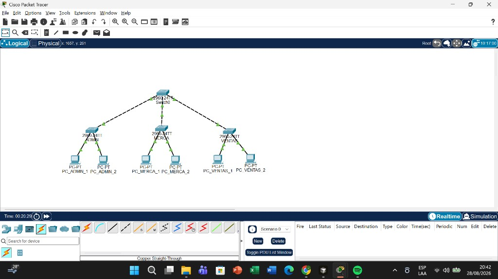
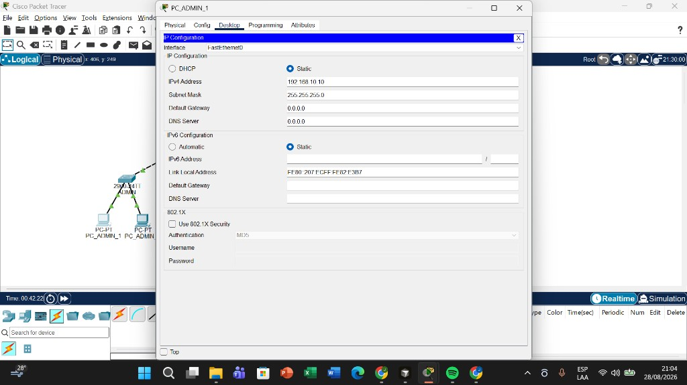
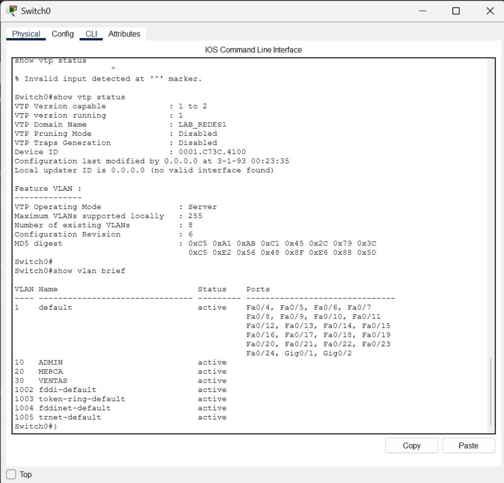
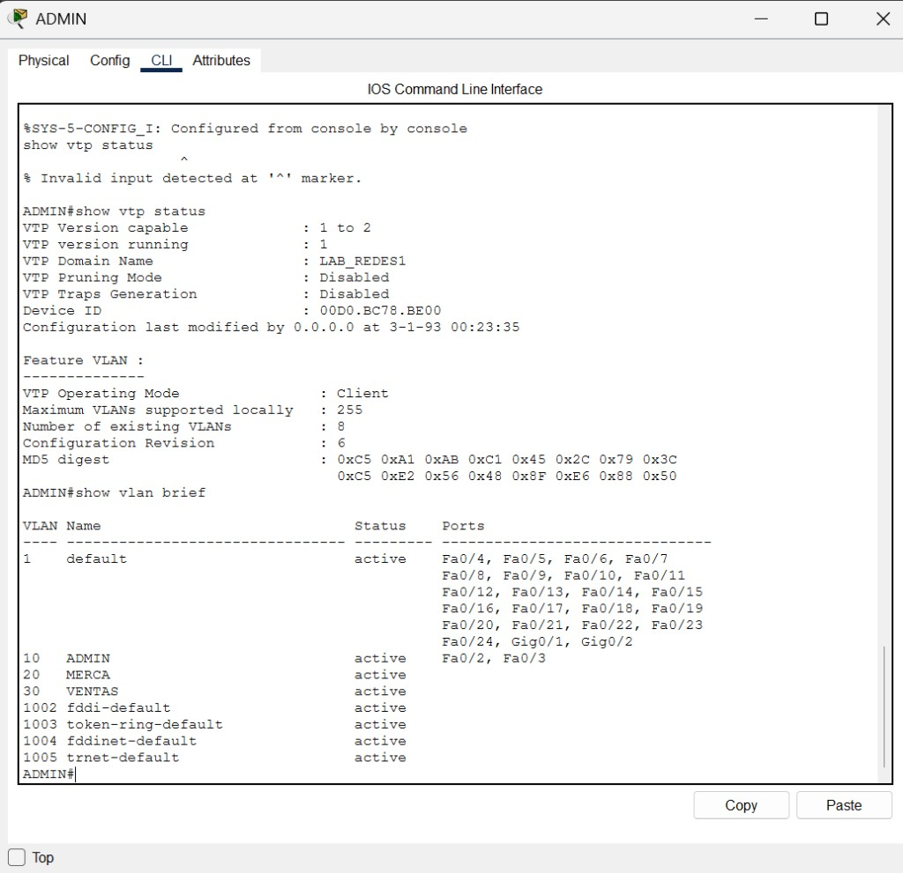
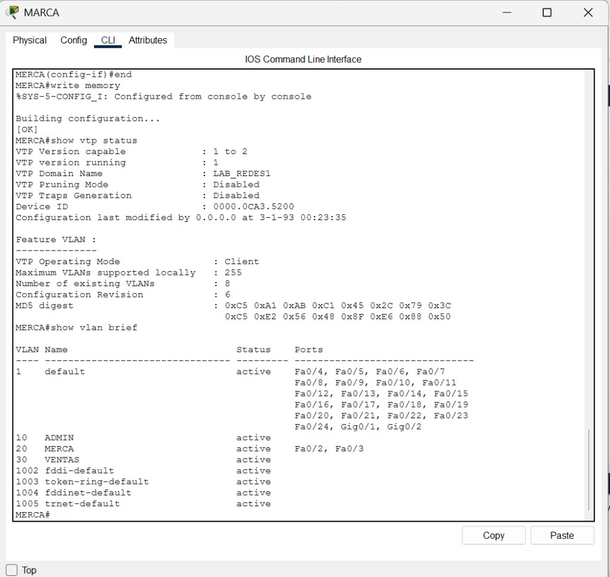
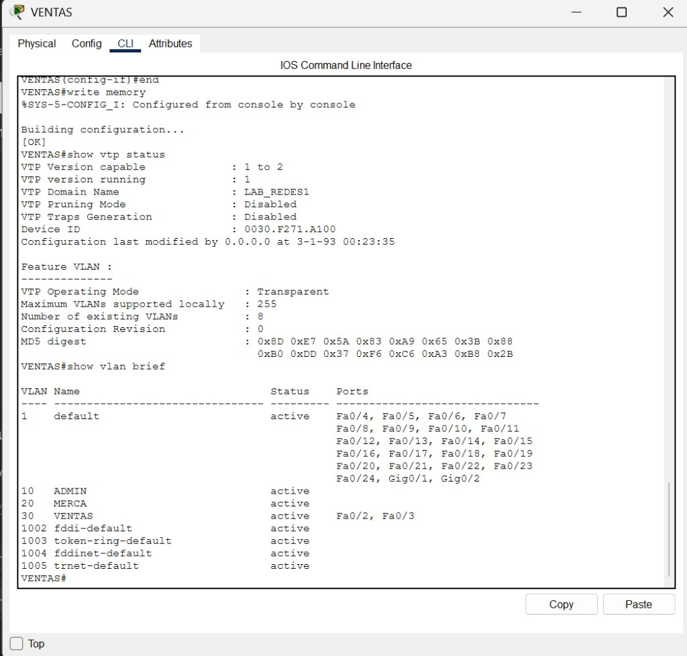
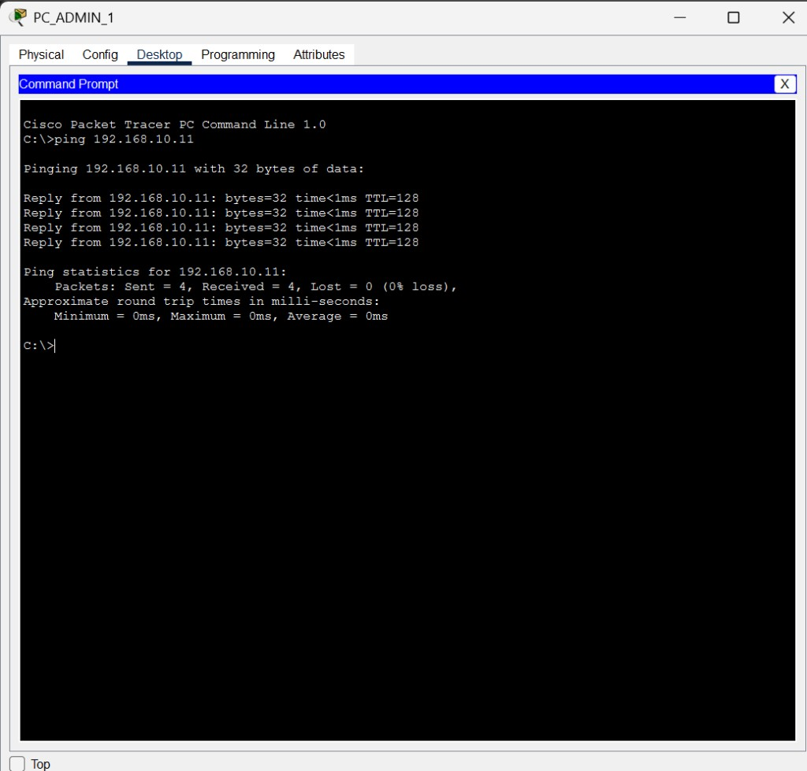
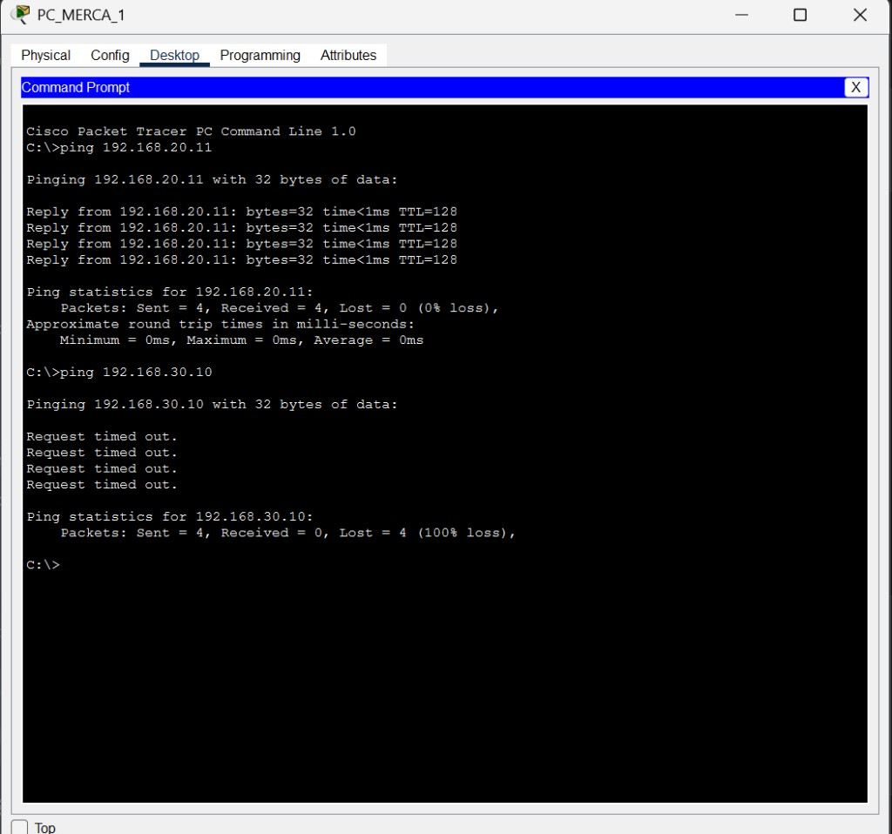
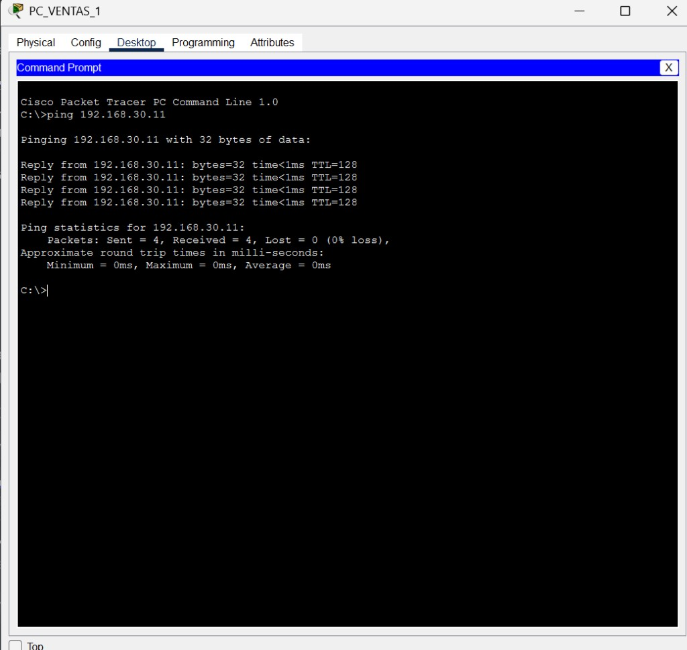
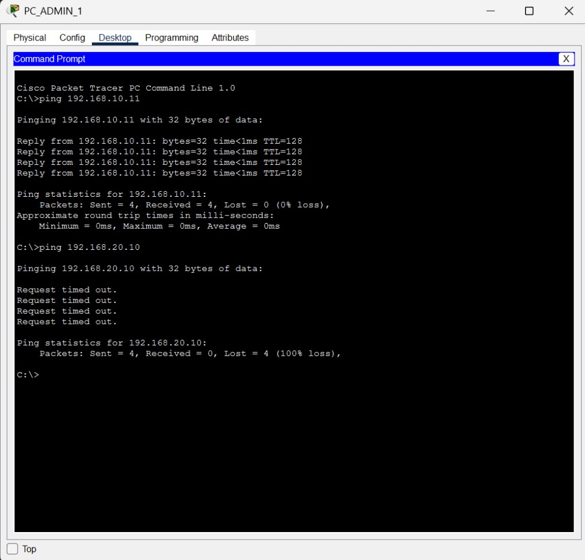

# Tarea #3 — Manual técnico

**Universidad San Carlos de Guatemala**  
Facultad de Ingeniería  
Escuela de Ingeniería en Ciencias y Sistemas  
Laboratorio — Redes de Computadoras 1 — A  
Segundo Semestre 2026

**Estudiante:** Josue Daniel Herrera Cottom  
**Carné:** 202300689

---

## 1. Marco formativo

### 1.1 Valores

| Nombre del valor | ¿Cómo se aplica en este laboratorio? |
|------------------|-------------------------------------|
| Orden | El cableado estructurado requiere aplicar normas internacionales y mantener la infraestructura organizada para asegurar rendimiento y facilidad de mantenimiento. En esta práctica se identificó cada enlace (trunk entre switches y access hacia PCs), se asignaron puertos fijos y se documentó la topología para que la red sea reproducible y fácil de verificar. |

### 1.2 Competencias

**Competencia general.** El estudiante será capaz de diseñar, implementar y evaluar redes de computadoras a nivel de las capas física, de enlace de datos y de red del modelo OSI aplicando conocimientos de cableado estructurado, direccionamiento IP, segmentación con VLANs y enrutamiento, para garantizar la conectividad, el rendimiento y la solución de problemas en entornos profesionales.

**Competencia específica.** El estudiante será capaz de implementar y verificar segmentación y redundancia en redes mediante la configuración de VLANs, VTP, STP y EtherChannel en switches Cisco, garantizando conectividad estable y evitando bucles en la topología.

### 1.3 Objetivo de la actividad

Configurar una red en Cisco Packet Tracer implementando VLANs y el protocolo VTP en modos servidor, cliente y transparente; verificar la propagación de VLANs entre switches; y comprobar la conectividad entre PCs de la misma VLAN mediante ping, identificando que el tráfico entre VLANs distintas no se entrega sin un dispositivo de capa 3.

---

## 2. Diseño de la topología

Se utilizaron **4 switches Cisco 2960** y **6 PCs**:

- Switch central: **Switch0**
- Switches de acceso: **ADMIN**, **MERCA**, **VENTAS**
- 2 PCs por switch de acceso. Switch0 no tiene PCs.

### 2.1 Enlaces trunk (switch de acceso ↔ Switch0)

| Extremo A | Puerto | Cable | Extremo B | Puerto |
|-----------|--------|-------|-----------|--------|
| Switch0 | FastEthernet0/1 | Copper Cross-Over | ADMIN | FastEthernet0/1 |
| Switch0 | FastEthernet0/2 | Copper Cross-Over | MERCA | FastEthernet0/1 |
| Switch0 | FastEthernet0/3 | Copper Cross-Over | VENTAS | FastEthernet0/1 |

### 2.2 Enlaces access (PC ↔ switch)

| PC | Switch | Puerto del switch | VLAN |
|----|--------|-------------------|------|
| PC_ADMIN_1 | ADMIN | FastEthernet0/2 | 10 (ADMIN) |
| PC_ADMIN_2 | ADMIN | FastEthernet0/3 | 10 (ADMIN) |
| PC_MERCA_1 | MERCA | FastEthernet0/2 | 20 (MERCA) |
| PC_MERCA_2 | MERCA | FastEthernet0/3 | 20 (MERCA) |
| PC_VENTAS_1 | VENTAS | FastEthernet0/2 | 30 (VENTAS) |
| PC_VENTAS_2 | VENTAS | FastEthernet0/3 | 30 (VENTAS) |

Los puertos de PC se conectaron con **Copper Straight-Through** a **FastEthernet0** de cada PC.

### 2.3 Evidencia de la topología en Packet Tracer



---

## 3. VLANs, VTP y direccionamiento

| VLAN ID | Nombre | Red | Máscara |
|---------|--------|-----|---------|
| 10 | ADMIN | 192.168.10.0/24 | 255.255.255.0 |
| 20 | MERCA | 192.168.20.0/24 | 255.255.255.0 |
| 30 | VENTAS | 192.168.30.0/24 | 255.255.255.0 |

**Dominio VTP:** `LAB_REDES1` (el mismo en los cuatro switches).  
**Contraseña VTP:** no se utilizó.

| Switch | Modo VTP |
|--------|----------|
| Switch0 | Servidor |
| ADMIN | Cliente |
| MERCA | Cliente |
| VENTAS | Transparente |

En modo **transparente**, VENTAS no aprende VLANs por VTP; las tres VLANs se crearon de forma local en ese switch.

No se configuró gateway ni router: el ping entre VLANs distintas debe fallar.

| PC | Dirección IPv4 | Máscara | Gateway |
|----|----------------|---------|---------|
| PC_ADMIN_1 | 192.168.10.10 | 255.255.255.0 | (ninguno) |
| PC_ADMIN_2 | 192.168.10.11 | 255.255.255.0 | (ninguno) |
| PC_MERCA_1 | 192.168.20.10 | 255.255.255.0 | (ninguno) |
| PC_MERCA_2 | 192.168.20.11 | 255.255.255.0 | (ninguno) |
| PC_VENTAS_1 | 192.168.30.10 | 255.255.255.0 | (ninguno) |
| PC_VENTAS_2 | 192.168.30.11 | 255.255.255.0 | (ninguno) |

Ejemplo de configuración IP (PC_ADMIN_1):



---

## 4. Scripts de configuración

Orden aplicado: trunks → dominio y modo VTP → VLANs en el servidor → VLANs locales en VENTAS → puertos access.

### 4.1 Switch0 (servidor VTP)

```
enable
configure terminal
hostname Switch0
vtp mode server
vtp domain LAB_REDES1
interface FastEthernet0/1
 switchport mode trunk
 no shutdown
interface FastEthernet0/2
 switchport mode trunk
 no shutdown
interface FastEthernet0/3
 switchport mode trunk
 no shutdown
vlan 10
 name ADMIN
vlan 20
 name MERCA
vlan 30
 name VENTAS
end
write memory
```

### 4.2 Switch ADMIN (cliente VTP)

```
enable
configure terminal
hostname ADMIN
vtp mode client
vtp domain LAB_REDES1
interface FastEthernet0/1
 switchport mode trunk
 no shutdown
interface FastEthernet0/2
 switchport mode access
 switchport access vlan 10
 no shutdown
interface FastEthernet0/3
 switchport mode access
 switchport access vlan 10
 no shutdown
end
write memory
```

### 4.3 Switch MERCA (cliente VTP)

```
enable
configure terminal
hostname MERCA
vtp mode client
vtp domain LAB_REDES1
interface FastEthernet0/1
 switchport mode trunk
 no shutdown
interface FastEthernet0/2
 switchport mode access
 switchport access vlan 20
 no shutdown
interface FastEthernet0/3
 switchport mode access
 switchport access vlan 20
 no shutdown
end
write memory
```

### 4.4 Switch VENTAS (VTP transparente)

```
enable
configure terminal
hostname VENTAS
vtp mode transparent
vtp domain LAB_REDES1
interface FastEthernet0/1
 switchport mode trunk
 no shutdown
vlan 10
 name ADMIN
vlan 20
 name MERCA
vlan 30
 name VENTAS
interface FastEthernet0/2
 switchport mode access
 switchport access vlan 30
 no shutdown
interface FastEthernet0/3
 switchport mode access
 switchport access vlan 30
 no shutdown
end
write memory
```

---

## 5. Verificación: `show vtp status` y `show vlan brief`

### 5.1 Switch0

- **VTP Operating Mode:** Server  
- **VTP Domain Name:** LAB_REDES1  
- VLANs 10 (ADMIN), 20 (MERCA) y 30 (VENTAS) activas.  
- Fa0/1, Fa0/2 y Fa0/3 no aparecen en `show vlan brief` porque están en modo **trunk**.



### 5.2 ADMIN

- **VTP Operating Mode:** Client  
- **VTP Domain Name:** LAB_REDES1  
- VLANs 10, 20 y 30 presentes (propagadas por VTP).  
- Fa0/2 y Fa0/3 asignados a VLAN 10.



### 5.3 MERCA

- **VTP Operating Mode:** Client  
- **VTP Domain Name:** LAB_REDES1  
- Fa0/2 y Fa0/3 asignados a VLAN 20.



### 5.4 VENTAS

- **VTP Operating Mode:** Transparent  
- **VTP Domain Name:** LAB_REDES1  
- **Configuration Revision:** 0 (esperado en modo transparente).  
- Fa0/2 y Fa0/3 asignados a VLAN 30. Las VLANs 10, 20 y 30 existen porque se crearon de forma local.



---

## 6. Pruebas de conectividad (ping)

### 6.1 Misma VLAN (éxito)

| Origen | Destino | Comando | Resultado |
|--------|---------|---------|-----------|
| PC_ADMIN_1 (192.168.10.10) | PC_ADMIN_2 (192.168.10.11) | `ping 192.168.10.11` | 4 recibidos, 0% pérdida |
| PC_MERCA_1 (192.168.20.10) | PC_MERCA_2 (192.168.20.11) | `ping 192.168.20.11` | 4 recibidos, 0% pérdida |
| PC_VENTAS_1 (192.168.30.10) | PC_VENTAS_2 (192.168.30.11) | `ping 192.168.30.11` | 4 recibidos, 0% pérdida |







### 6.2 Distinta VLAN (fallo)

Sin router no hay enrutamiento inter-VLAN. El aislamiento es el comportamiento esperado.

| Origen | Destino | Comando | Resultado |
|--------|---------|---------|-----------|
| PC_ADMIN_1 | PC_MERCA_1 (192.168.20.10) | `ping 192.168.20.10` | Request timed out, 100% pérdida |
| PC_MERCA_1 | PC_VENTAS_1 (192.168.30.10) | `ping 192.168.30.10` | Request timed out, 100% pérdida |



---

## 7. Conclusiones

- La topología de cuatro switches 2960 y seis PCs quedó operativa, con trunks entre Switch0 y los switches de acceso, y puertos access hacia las PCs.
- VTP en dominio `LAB_REDES1` operó como servidor en Switch0, cliente en ADMIN y MERCA, y transparente en VENTAS.
- ADMIN y MERCA recibieron las VLANs 10, 20 y 30 desde el servidor. VENTAS requirió creación local de VLANs por su modo transparente.
- El ping entre PCs de la misma VLAN fue exitoso. El ping entre VLANs distintas falló, lo que confirma la segmentación de capa 2.

---

## 8. Entregables

| Archivo | Descripción |
|---------|-------------|
| `Tarea3.pkt` | Simulación en Cisco Packet Tracer *(guardar con File → Save As en esta carpeta)* |
| `Manual_Tecnico.md` | Este manual |
| `evidencias/` | Capturas de topología, CLI y pings |
